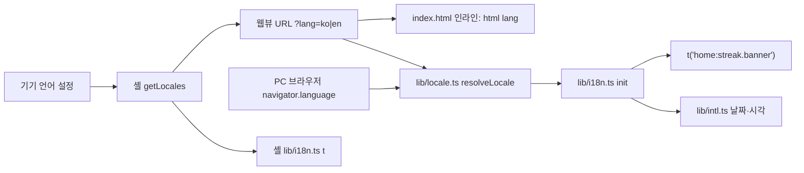

# BY-731 국제화(i18n) 설계

- 티켓: BY-731 (하위 BY-808~812, 후속 BY-813·814·815, 약관 영어판 BY-1117)
- 기준: dev `ab8445b0` (2026-11-03), 브랜치 `feature/BY-731-i18n`
- 기획 명세: `.ai/product/specs/BY-731-국제화.md` (정책 결정의 원본, 위키, 아직 올라가지 않음)
- 런타임 결정: `docs/adr/0012-i18n-runtime-react-i18next.md`
- 작성: 2026-10-01, 갱신: 2026-11-03 (11월 병렬 레인 결정과 dev `ab8445b0` 반영)

## 왜

앱 문구는 전부 한국어로 코드에 직접 적혀 있다. 11/3 dev 기준으로 웹은 183개 파일에 한글이 든 코드 줄이 1,331줄이다. 법무 문서 238줄, 개발용 화면, 테스트 픽스처를 빼도 1,000줄 안팎이다. 모바일 셸은 45개 파일 191줄인데 이 중 절반 이상은 로그와 빌드 오류 메시지다. 날짜·시간 표기는 KST와 한국어 단위를 손으로 조립한다.

11/29까지 EU를 뺀 영어권 출시를 목표로 한다. 이번 범위는 영어 하나이고, 인프라는 번역 파일 한 세트를 더하는 것만으로 다음 언어가 늘어나게 만든다.

## 확정한 결정

| 항목                  | 결정                                                                                                                                                                | 근거                                                                                                                                                     |
| --------------------- | ------------------------------------------------------------------------------------------------------------------------------------------------------------------- | -------------------------------------------------------------------------------------------------------------------------------------------------------- |
| 웹 런타임             | react-i18next (새 의존성, 2026-10-01 승인)                                                                                                                          | 사실상 표준이고 jsdom 테스트에 바로 올라간다. Paraglide는 Vite 플러그인과 vitest 연동을 따로 확인해야 하고, 자체 구현은 복수형·보간을 다시 만들어야 한다 |
| 카탈로그 구조         | `apps/web/src/locales/{ko,en}/<namespace>.json`, 네임스페이스는 기능 폴더 이름                                                                                      | 문구 추출을 기능 묶음별로 병렬 진행해도 파일이 겹치지 않는다                                                                                             |
| 지원 언어와 폴백      | `ko`, `en`. `ko*`가 아니면 전부 `en`                                                                                                                                | 티켓 완료 조건                                                                                                                                           |
| 언어 출처             | 웹뷰는 셸이 붙인 `?lang=`, PC 웹은 `navigator.language`                                                                                                             | 셸에서 웹으로 설정을 넘기는 기존 관례(`?theme`)와 같다                                                                                                   |
| 실행 중 언어 변경     | 메시지를 두지 않는다                                                                                                                                                | iOS는 앱별 언어를 바꾸면 앱을 재시작하고, Android도 액티비티를 다시 만들어 웹뷰가 새 URL로 뜬다                                                          |
| 앱 안 언어 선택 UI    | 없음, BY-813                                                                                                                                                        | 기기 설정을 따른다                                                                                                                                       |
| 시간대                | BY-808은 지금 출력을 유지한다. 하루 경계(`statDate`)와 D-Day를 기기 시간대로 바꾸는 일은 BY-814(BE)·BY-815(FE)가 한다                                               | 11/1 결정으로 "KST 유지"가 뒤집혔다. `intl.ts`의 날짜 라벨은 시간대 상수 하나를 읽게 해서 BY-815가 그 한 곳만 바꾸게 한다                                |
| 모바일 기기 언어      | `expo-localization`의 `getLocales()`                                                                                                                                | Expo 표준. 네이티브 모듈이 하나 늘어 Dev Client 재빌드가 필요하고, 네이티브 변경 동결일(11/20) 전에 들어가야 한다                                        |
| 모바일 셸 문구        | `lib/i18n.ts`에 ko·en 객체와 `t()` 하나                                                                                                                             | 앱 잠금 화면이 늘었어도 사용자 노출 문구가 80줄 안팎이라 라이브러리를 넣지 않는다                                                                        |
| Android 네이티브 문구 | `AppLockService.kt`·`ProfilePhotoPickerModule.kt`의 알림·안내 문구를 모듈 `res/values/strings.xml`(영어 기본)과 `res/values-ko/strings.xml`로 바꾼다                | Android 표준 리소스라 기기 언어를 OS가 고른다. 기본을 영어로 둬야 ko가 아닌 기기에서 영어가 보인다                                                       |
| 린트                  | `no-restricted-syntax`에 한글 정규식 셀렉터, 새 의존성 없음. 적용 범위는 추출이 끝난 폴더 목록이고 묶음마다 넓힌다. 마지막 묶음에서 `src/**` 전체로 바꾼다          | BY-808을 먼저 머지해야 하는데, 처음부터 전체에 걸면 lint가 실패한다                                                                                      |
| 개발용 화면           | `WorkerParityPage`, `WebrtcLoopbackPage`, `VisionPerfPanel`, `lib/rankingFixtures.ts`, `lib/rankingMock.ts`, `app.config.ts` 빌드 오류 메시지는 번역 제외·린트 예외 | 사용자가 보지 않는다                                                                                                                                     |
| 로그·오류 객체 메시지 | `throw new Error`, `console.*`, Sentry 메시지의 한국어는 번역하지 않는다. 린트 예외는 해당 줄에 두지 않고, 문구를 영어로 바꾼다                                     | 사용자에게 보이지 않고, 예외 주석이 늘면 린트가 의미를 잃는다                                                                                            |
| 약관·개인정보처리방침 | 영어판은 BY-1117(사용자 번역). 그때까지 영어 UI에서는 본문 위에 `This document is currently available in Korean only.` 한 줄을 보인다                               | 11/2 결정                                                                                                                                                |
| 스토어 메타           | `CFBundleLocalizations`, 권한 문구, 앱 이름 영어판은 BY-811. 스토어 소개글은 BY-811에서 초안을 쓰고, 영어 스크린샷은 W4에 사용자가 찍는다                           | 11/2 결정                                                                                                                                                |
| 영문 앱 이름          | FocusMakers                                                                                                                                                         | 용어사전 확정값                                                                                                                                          |
| 영어 번역 검토        | 용어사전은 출발점일 뿐이고, 영어 카탈로그는 사용자가 추출 PR마다 검토한다. 낡은 영어 용어는 용어사전도 고친다                                                       | 용어사전이 오래됐다                                                                                                                                      |
| 닉네임 기본값         | `포메12345` 형식은 유지한다(BY-813에서 다룬다)                                                                                                                      | 11/2 결정                                                                                                                                                |
| 세션 제출 오류        | 서버 `message`를 그대로 보이지 않고 `code`로 카탈로그 문구를 고른다. 모르는 코드는 공용 오류 문구                                                                   | 서버 메시지는 한국어로 온다                                                                                                                              |

## 아키텍처

### 로케일 결정

`apps/web/src/lib/locale.ts`에 순수 함수 하나를 둔다.

```ts
export type AppLocale = "ko" | "en";
export function resolveLocale(search: string, navigatorLanguage: string | undefined): AppLocale;
```

규칙은 `?lang` 값이 있으면 그것을, 없으면 `navigator.language`를 보고, `ko`로 시작하면 `ko`, 아니면 `en`이다. `index.html`의 인라인 스크립트가 같은 규칙으로 `document.documentElement.lang`을 첫 페인트 전에 붙인다. 모듈 번들은 첫 페인트 뒤에 평가되므로 `main.tsx`에서 하면 한 프레임 늦는다(`?theme`과 같은 이유). 두 구현이 같은 규칙인지는 `indexHtml.test.ts`가 고정한다.

SPA 안의 화면 이동은 문서를 다시 읽지 않아 처음 정한 언어가 유지된다. `lib/hardNavigation.ts`처럼 문서를 새로 여는 이동은 `?lang`이 빠지므로, 처음 정한 언어를 `sessionStorage`에 적고 `?lang`이 없는 진입은 그 값을 `navigator.language`보다 먼저 본다. Android 앱별 언어와 시스템 언어가 다를 때 웹뷰의 `navigator.language`가 시스템 언어를 돌려줄 수 있어서다. 인라인 스크립트도 같은 순서로 읽는다.

### i18n 초기화

`apps/web/src/lib/i18n.ts`가 `i18next.use(initReactI18next).init(...)`을 한다. `main.tsx`가 `initNativeTheme()` 옆에서 부른다.

- `lng`: `resolveLocale(location.search, navigator.language)`
- `supportedLngs: ["ko", "en"]`, `fallbackLng: "en"`
- `resources`: ko·en 네임스페이스 JSON을 정적 import로 전부 싣는다. 두 언어 합쳐 수십 KB라 지연 로딩은 하지 않는다
- `interpolation.escapeValue: false` (React가 이스케이프한다)
- `initAsync: false` (테스트에서 동기 초기화, 설치된 i18next 버전의 옵션 이름을 확인한다)

타입은 `apps/web/src/i18next.d.ts`에서 `declare module "i18next"`로 `CustomTypeOptions.resources`에 ko JSON을 선언한다. 키 오타가 typecheck에서 잡히고, en은 ko와 키 집합이 같아야 하므로 테스트 가드로 잡는다.

### 카탈로그

네임스페이스 이름은 기능 폴더 이름과 같다. `routes/*Page.tsx`는 그 화면이 속한 기능의 네임스페이스를 쓴다.

| 네임스페이스           | 담는 화면·기능                                                                                | 묶음          |
| ---------------------- | --------------------------------------------------------------------------------------------- | ------------- |
| `common`               | 확인·취소·닫기·뒤로 같은 공용 버튼, 공용 aria-label, 로딩·오류 공용 문구, 시간 길이·횟수 단위 | 기반 (BY-808) |
| `records`              | 기록 탭, 기간 선택, 주간 추이, 세션 목록                                                      | A             |
| `ranking`              | 랭킹 탭, 기록 시트, 메달·순위 변동 노출                                                       | A             |
| `planner`              | 플래너, 과목                                                                                  | A             |
| `manual-record`        | 수동 기록                                                                                     | A             |
| `multi-timer`          | 멀티 타이머                                                                                   | A             |
| `timelapse`            | 타임랩스 목록·설정·공유                                                                       | A             |
| `notice`               | 공지                                                                                          | A             |
| `interview`            | 인터뷰 신청                                                                                   | A             |
| `settings`             | 설정, 서비스 정보, 약관 화면의 영어 안내 한 줄, 문의·다운로드·라이선스                        | B             |
| `profile`              | 프로필 편집, 카테고리 칩                                                                      | B             |
| `app-lock`             | 앱 잠금 설정 화면(웹 쪽)                                                                      | B             |
| `ambient-sound`        | 배경음 카탈로그·시트                                                                          | B             |
| `force-update`         | 강제·권장 업데이트                                                                            | B             |
| `measurement-feedback` | 측정 피드백                                                                                   | B             |
| `onboarding`           | 첫 실행 온보딩, 목업 화면                                                                     | B             |
| `home`                 | 홈 탭, D-Day 섹션·시트·달력, 스탯 카드                                                        | C             |
| `live-room`            | 라이브 룸                                                                                     | C             |
| `social-room`          | 초대 코드 공유·참여, 소셜 룸 오류                                                             | C             |
| `study-session`        | 세션 화면, 상태 필, 복구 다이얼로그, 결과 화면, 도움말                                        | C             |

묶음 C는 시간대(BY-815), 공간 테마(BY-1116), 소셜 로그인과 파일이 겹친다. 그래서 마지막에 하고, 착수 직전에 dev를 다시 받는다.

키는 의미 기반이다(`home:streak.banner`처럼 화면·요소·역할). 문구 자체를 키로 쓰지 않는다. 복수형은 i18next 규칙(`_one`/`_other`)이고, 한국어는 복수형이 없어 접미 없는 키 하나만 둔다. 변수는 `{{count}}`, `{{name}}`처럼 이름을 붙인다. 문장 안에 강조나 링크가 섞이면 `Trans` 컴포넌트를 쓴다.

기존 문구 상수 파일(`sessionCopy.ts`, `resultCopy.ts`, `sessionHelpCopy.ts`, `joinErrorCopy.ts`, `measurementFeedbackCopy.ts`, `force-update/copy.ts`)은 카탈로그로 바꾸고 파일은 삭제한다. 상수 이름을 참조하던 테스트는 카탈로그 값이나 `t()` 결과를 참조하게 바꾼다.

### 셸에서 웹으로

`apps/mobile/components/RemoteWebViewHost.tsx`의 `buildRemoteWebViewUrl`이 URL을 만들 때 `lang`을 붙인다. `buildRemoteQueryParams`의 캐시(`cachedParams`)에는 넣지 않는다. Android에서 앱별 언어를 바꾸면 액티비티만 다시 만들어지고 JS 모듈 캐시는 남으므로, 캐시에 넣으면 이전 언어가 남는다. 값은 `getLocales()[0].languageCode`가 `ko`면 `ko`, 아니면 `en`이다.

브리지 메시지 타입(`packages/types/src/bridge.ts`)은 바꾸지 않는다.

### 날짜·시간·숫자

`apps/web/src/lib/intl.ts`로 모은다. 지금 흩어진 헬퍼(`recordsFormat.ts`, `ranking/model/format.ts`, 홈·D-Day 포맷, `formatDuration`, 결과 화면, 인라인 템플릿)는 이 모듈과 카탈로그를 부르는 얇은 함수로 남기거나 호출부에서 직접 쓴다. 각 헬퍼는 자기 묶음의 추출 때 바꾼다. BY-808은 `intl.ts`와 그 테스트만 만든다.

| 표기                  | 구현                                                                                                                                                                 | ko 출력(변화 없음)      | en 출력                          |
| --------------------- | -------------------------------------------------------------------------------------------------------------------------------------------------------------------- | ----------------------- | -------------------------------- |
| 날짜 라벨             | `Intl.DateTimeFormat(locale, { timeZone: STAT_TIME_ZONE, month: "long", day: "numeric", weekday: "long" })`                                                          | 10월 1일 목요일         | Thursday, October 1              |
| 월 라벨               | 같은 방식, `year`·`month`                                                                                                                                            | 2026년 10월             | October 2026                     |
| 세션 시각 범위        | `Intl.DateTimeFormat(locale, { timeZone: STAT_TIME_ZONE, hour, minute })`에 ko는 `hour: "2-digit"`·`hourCycle: "h23"`, en은 `hour: "numeric"`과 로케일 기본 12시간제 | 21:03 – 22:48           | 9:03 PM – 10:48 PM               |
| 시간 길이             | `common` 카탈로그 키                                                                                                                                                 | 3시간 42분              | 3h 42m (영어 표기 규칙에서 확정) |
| 횟수·집중률·연속 일수 | 카탈로그 복수형 키                                                                                                                                                   | 공부 3회, 82% 집중, 3일 | 3 sessions, 82% focused, 3 days  |
| 라이브 타이머         | 숫자만, 변화 없음                                                                                                                                                    | 01:24:05                | 01:24:05                         |
| 날짜 키(`YYYY-MM-DD`) | `todayKstDateKey` 유지                                                                                                                                               |                         |                                  |

`STAT_TIME_ZONE`은 `intl.ts`가 내보내는 상수이고 지금 값은 `"Asia/Seoul"`이다. 하루 경계가 KST 컬럼(`statDate`)이라 날짜 라벨과 세션 시각(지금 `formatKstClock`)도 KST로 표시하고 있고, BY-808은 이 출력을 바꾸지 않는다. BY-815가 이 상수와 `dateKst.ts`를 기기 시간대로 바꾼다.

`lib/graphemes.ts`의 `Intl.Segmenter("ko")`는 글자 단위 분할이라 언어와 무관하므로 손대지 않는다. react-day-picker는 `locale` prop을 `ko`·`enUS` 중에서 고른다.

### 모바일 셸

- `apps/mobile/lib/i18n.ts`: `const copy = { ko: {...}, en: {...} } as const`와 `t(key)`. 언어는 `getAppLocale()`이 부를 때마다 `getLocales()[0].languageCode`로 읽는다. Android는 앱별 언어를 바꾸면 액티비티만 다시 만들고 JS 모듈은 남기 때문이다. 같은 이유로 `expo-localization`의 `allowDynamicLocaleChangesAndroid`는 `false`로 둔다.
- 바꾸는 화면: 권한 거부, 탭 바(`TabBar.tsx`, `NativeTabsLayout.ios.tsx`, `(tabs)/_layout.tsx`), 앱 잠금(`app-lock-consent`, `app-lock-picker`, `app-lock-battery`), 업데이트 안내(`forceUpdateCopy.ts`, `recommendedUpdateCopy.ts`), 웹뷰 로드 실패(`RemoteWebViewHost.tsx`), 영상 저장·공유 안내(`videoTransfer.ts`), `LaunchGoalOverlay`. 실제 목록은 BY-811 착수 때 사용자 노출 여부로 다시 고른다.
- `lib/remoteConfigCopy.ts`의 `readCopyOr`는 영어일 때 `<key>_en`을 먼저 읽고 없으면 영어 기본 문구를 쓴다. 한국어 경로는 그대로다.
- 로그·오류 메시지(`auth.ts`의 "유저 등록 실패" 등)는 사용자 노출이 아니라 번역하지 않는다.

### 스토어 메타

- `app.json` `ios.infoPlist.CFBundleLocalizations`를 `["ko", "en"]`으로 바꾼다. `CFBundleDevelopmentRegion`은 `ko`를 유지한다.
- `app.json` `expo.locales`에 `apps/mobile/locales/{en,ko}.json`을 둔다. 키는 권한 문구(카메라, 모션, 추적, 사진, 스크린타임 등 지금 `infoPlist`에 있는 것 전부)와 `CFBundleDisplayName`이다. ko 파일은 지금 값 그대로다.
- `expo-localization` config plugin에 `supportedLocales: ["ko", "en"]`을 준다. iOS 설정 앱의 앱별 언어와 Android 13+ 앱별 언어가 이걸로 켜진다.
- 앱 이름: `app.config.ts`가 빌드 변형 접미를 붙여 `locales`의 `CFBundleDisplayName`(iOS)과 `android.app_name`(Android `values-b+en`)으로 넣는다. `plugins/withAppDisplayName.js`는 기본 `app_name`의 `translatable="false"`만 지운다.
- 스토어 소개글 영어 초안은 BY-811 수행 보고서에 둔다. 스토어 콘솔 입력과 스크린샷은 사용자가 한다.

### 린트

`apps/web/eslint.config.mjs`에 블록 하나를 더한다.

```js
const I18N_ENFORCED = ["src/lib/i18n.ts", "src/lib/locale.ts", "src/lib/intl.ts"]; // 묶음마다 폴더를 더한다
{
  files: I18N_ENFORCED,
  ignores: [/* 테스트, 개발용 화면, legalDocuments.ts */],
  rules: {
    "no-restricted-syntax": ["error",
      { selector: "Literal[value=/[가-힣]/]", message: HANGUL_MESSAGE },
      { selector: "TemplateElement[value.raw=/[가-힣]/]", message: HANGUL_MESSAGE },
      { selector: "JSXText[value=/[가-힣]/]", message: HANGUL_MESSAGE },
    ],
  },
}
// HANGUL_MESSAGE = "사용자 문구는 locales/ 카탈로그에 두고 t()로 읽는다"
```

11/3 기준 `baseConfig`와 웹 설정은 `no-restricted-syntax`를 쓰지 않는다. 묶음 C가 끝나면 `I18N_ENFORCED`를 `["src/**/*.{ts,tsx}"]`로 바꾼다. 주석은 AST 노드가 아니라 규칙에 걸리지 않는다.

모바일 `eslint.config.mjs`도 BY-811에서 같은 규칙을 넣고 `lib/i18n.ts`, `app.config.ts`, 테스트, `plugins/**`를 예외로 둔다.

## 데이터 흐름



## 오류 처리

- 키가 없으면 i18next는 키 문자열을 그대로 돌려준다. ko·en 키 집합 일치 가드와 타입 키로 운영에서 이 상황을 막는다.
- `?lang`에 이상한 값이 오면 `en`으로 떨어진다. 구버전 앱은 `?lang`을 붙이지 않으므로 `navigator.language`로 떨어지고, WKWebView·Android WebView는 기기 언어를 돌려준다.
- `getLocales()`가 빈 배열을 돌려주면 `en`으로 둔다.
- Remote Config에 `_en` 키가 없으면 영어 기본 문구를 쓴다. 한국어 문구가 영어 UI에 섞이지 않는다.

## 테스트

`src/test/setup.ts`에서 `lib/i18n.ts`를 import해 ko로 동기 초기화한다. 한국어 단언이 든 테스트 파일 수백 개는 손대지 않아도 그대로 통과한다. react-i18next는 전역 인스턴스를 쓰므로 Provider를 감쌀 필요가 없다.

새로 쓰는 테스트:

| 대상                           | 케이스                                                                                                                          | 하위 티켓 |
| ------------------------------ | ------------------------------------------------------------------------------------------------------------------------------- | --------- |
| `lib/locale.ts`                | `?lang=en`, `?lang=ko`, `?lang=xx`, 쿼리 없음 + `navigator.language`가 `ko-KR`·`en-US`·`ja-JP`·undefined, 저장된 언어가 있을 때 | BY-808    |
| `index.html` 인라인 스크립트   | `resolveLocale`과 같은 입력에서 같은 `lang`을 붙이는지(`indexHtml.test.ts`에 추가)                                              | BY-808    |
| `lib/intl.ts`                  | 날짜·월·시각 범위를 ko·en 각각, 시간대는 `Asia/Seoul`과 `America/New_York`을 고정해 검사                                        | BY-808    |
| `lib/i18n.ts`                  | 테스트 환경에서 ko로 초기화되고 `common` 키를 읽는다, en으로 바꾸면 영어 값이 나온다                                            | BY-808    |
| 카탈로그 가드                  | ko·en 네임스페이스마다 키 집합이 같다, 값이 빈 문자열이 아니다, 보간 변수 이름이 같다                                           | BY-808    |
| 묶음별 영어 렌더               | 묶음마다 대표 화면 하나를 en으로 렌더해 한글이 남지 않았는지                                                                    | BY-809    |
| 셸 `lib/i18n.ts`               | `getLocales` mock으로 ko·en·빈 배열                                                                                             | BY-811    |
| 셸 URL 조립                    | `buildRemoteWebViewUrl`이 `lang`을 붙이고 캐시에 넣지 않는다                                                                    | BY-811    |
| `remoteConfigCopy.ts`          | 영어일 때 `_en` 키 우선, 없으면 영어 기본                                                                                       | BY-811    |
| `appStoreLocalization.test.ts` | `CFBundleLocalizations`가 `["ko","en"]`, `locales` 파일 키가 갖춰져 있다                                                        | BY-811    |

실기기(BY-812): Dev Client를 다시 빌드한 뒤 iOS·Android 기기 언어를 영어로 바꿔 홈·세션·결과·기록·랭킹·설정을 라이트·다크로 찍는다. 한국어 기기에서 문구가 달라지지 않았는지도 본다. Android는 Note10에서 본다.

## 일정과 순서

- BY-808을 11/6까지 dev에 머지한다. 그 뒤로 다른 레인이 새 문구를 쓸 때는 카탈로그 키로 쓴다.
- BY-811(모바일 셸·스토어 메타)은 네이티브 변경이라 11/20 동결 전에 머지한다.
- BY-809 묶음 A·B는 병렬, 묶음 C는 다른 레인이 해당 폴더를 머지한 뒤에 한다.

## 범위 밖

- 약관·개인정보처리방침 영어판 (BY-1117)
- 앱 안 언어 선택 UI, 닉네임 기본값 (BY-813)
- 하루 경계·D-Day의 사용자 시간대 (BY-814, BY-815)
- 영어 외 언어
- 실행 중 언어 변경 브리지 메시지
- 서버가 보내는 푸시 알림 문구의 영어판 (BE 작업)

## 이력서용 전후 수치

| 항목                                                | AS-IS                            | TO-BE                            | 측정           |
| --------------------------------------------------- | -------------------------------- | -------------------------------- | -------------- |
| 한글 하드코딩 코드 줄(웹, 주석·법무·개발 화면 제외) | 약 1,000줄 / 약 170파일          | 0 (린트가 보증)                  | 주석 제거 grep |
| 모바일 셸 노출 문구 하드코딩                        | 약 80줄                          | 0                                | 같은 방식      |
| 지원 언어                                           | 1                                | 2                                | 스토어 메타    |
| 새 언어 추가 시 고칠 파일                           | 전 화면                          | JSON 1세트 + `supportedLngs` 1곳 | 설계           |
| 웹 번들 크기(gzip)                                  | 기반 구축 전 `vite build`로 측정 | 기반 구축 후 재측정              | 수행 보고서    |

## 하네스 실행 구조

서브 에이전트 모드(팀 도구 없음), 파이프라인이다. 문구 추출만 폴더가 겹치지 않는 묶음 둘을 병렬로 돌린다. 오케스트레이터는 `.claude/skills/i18n-orchestrator`다.

| 순서 | 담당                 | 내용                                                                                | 끝나면                     |
| ---- | -------------------- | ----------------------------------------------------------------------------------- | -------------------------- |
| 1    | `i18n-infra-builder` | 런타임·`locale.ts`·`intl.ts`·`common` 네임스페이스·린트 골격·테스트 초기화 (BY-808) | QA M1                      |
| 2    | `string-migrator` ×2 | 묶음 A, 묶음 B (BY-809)                                                             | 묶음마다 QA M2             |
| 3    | `en-copywriter`      | 묶음별 영어 카탈로그 초안 + 영어 표기 규칙 초안 (BY-810)                            | 사용자 검토 게이트 → QA M3 |
| 4    | `i18n-infra-builder` | 모바일 셸·Android 리소스·스토어 메타 (BY-811)                                       | QA M4                      |
| 5    | `string-migrator`    | 묶음 C, 린트 전체 적용                                                              | QA M5                      |
| 6    | 사용자               | Dev Client 재빌드, 실기기 검증 (BY-812)                                             | 통합 보고                  |

에이전트 모델은 Opus 5.5 high다. 작업 폴더는 `<저장소 루트의 부모>/reports/i18n/_workspace/`다.

## 문서 배치

기획·정책·저장소 간 결정은 위키, 저장소 안의 설계·결정은 이 저장소에 둔다(`AGENTS.md`).

- 위키 `.ai/product/specs/BY-731-국제화.md`: 명세 템플릿, 정책 결정 표에 위 결정 전부
- 위키 `.ai/product/voice-tone.md`: 영어 표기 규칙 절 (en-copywriter 초안, 사용자 검토 뒤 확정)
- 위키 `.ai/project/glossary.md`: 영어 용어 정정분
- 이 저장소 `docs/adr/0012-i18n-runtime-react-i18next.md`: 런타임 선택 ADR
- 이 저장소 이 설계서: 어떻게 만드는지

위키 커밋·푸시는 승인 뒤에만 한다.
