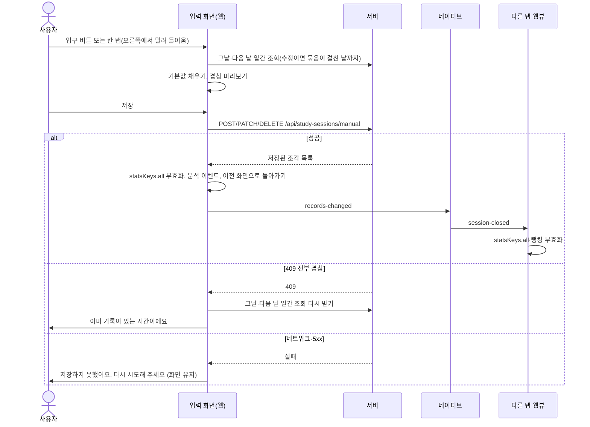

# BY-920 수동 기록 화면 설계

- 티켓: BY-920 `[FE] 기록 추가 시트·플래너·기록 탭 표시` (상위 BY-915, 선행 BY-919 시안·BY-921 BE API·BY-923 BE 묶음 키 노출)
- 명세: `.ai/product/specs/BY-915-수동-기록.md` (위키 main `9befa60`, §3 입구·§4 시트·§5 검증·§6 표시·§7 수정 삭제·§9 캐시·§10 분석·§11 문구·§12 접근성)
- 시안: Figma V2 `YcyImcuVORDbBneii41Byh` 섹션 `S12-1 · 수동 기록 · 플래너와 시트` (`6524:10852` 라이트, `6524:10853` 다크)
- 시안: 같은 파일 섹션 `S12-1 · 수동 기록 · 기록 탭과 삭제` (`6524:10854` 라이트, `6524:10855` 다크)
- 시안 컴포넌트: Button 컴포넌트 세트 `5458:498`에 `outline-primary`·`outline-destructive` `variant`와 연필 아이콘 슬롯이 있다.
- 설명 페이지: https://claude.ai/artifact/E9fbmTgXhsWFEQTYLaJPyF

## 배경

수동 기록은 사용자가 시작·종료 시각과 과목(선택)을 직접 넣어 공부 기록을 남기는 기능이다. 이 기록은 홈의 오늘 합계, 기록 탭, 플래너, 과목별 누적 같은 개인 기록에만 들어가고 랭킹·연속 공부·집중률에는 들어가지 않는다. 백엔드 API `POST/PATCH/DELETE /api/study-sessions/manual` (`API-Version: 1`)은 BY-921로 dev에 머지됐다. 서버는 기존 기록과 겹치는 구간을 잘라 내고 KST 자정에서 조각을 나누며, 나뉜 조각은 같은 `submissionStartedAt`을 묶음 키로 공유한다. 이 문서는 그 API를 쓰는 FE 화면 설계다.

## 조사에서 확인한 사실

origin/dev `02502a27` 기준이다.

### 브리지·캐시

- `records-changed` 브리지 메시지는 웹, 모바일, `packages/types` 어디에도 없다.
- 가장 가까운 메시지는 `session-closed`로, 네이티브가 모든 탭 웹뷰에 보내고 웹의 `useNativeSessionClosed`가 `statsKeys.all`과 랭킹 키를 무효화한다.
- 과목 목록용 react-query 키는 없고, `useSubjects`는 로컬 state 저장소다.
- 플래너는 과목 목록을 일간 통계 조회에서 받아 온다.

### 아직 없는 것

- `<input type="time">`을 쓰는 곳이 없다.
- Button에 `outline-primary`·`outline-destructive` `variant`가 없다.
- `packages/types`의 `StudySessionSummary`·`StudySessionResponse`에 `source`와 `submissionStartedAt`이 없다.
- 백엔드 DTO에는 `source`가 있고 `submissionStartedAt`은 없어서 BY-923이 이를 추가한다.

### 플래너

- `PlannerPage.tsx`는 `PlannerSubjects`와 `PlannerTimetable`을 그린다.
- `PlannerTimetable`은 10분짜리 144칸을 `role="img"`로 그리고 클릭을 처리하지 않는다.
- `plannerDay.ts`에는 `PlannerPaintKind`(`subject`|`focus`|`rest`)와 `assemblePlannerDay(dateKey, dayStats, nextDayStats)`가 있다.
- `usePlannerDay`는 미래 날짜면 조회를 끈다.
- 범례는 `PlannerSubjects.tsx`에 있다.

### 기록 탭

- `RecordsPage.tsx`의 `RecordsContent`는 Card > Accordion > `SessionListItem` 행과 `SessionTimelineLegend`를 그린다.
- 행에는 큰 집중 시간, `총 N`, Badge `집중 N%`, 미니 타임라인이 있다.
- 행을 펼치면 `시작`·`종료`·`최대 집중`을 dl로 보여 준다.

### 참고할 기존 코드

- 폼 시트의 본보기는 `features/home/DdaySection.tsx`다.
- 이 시트는 Radix `Sheet` side bottom, `theme-soft-blue`, `onOpenAutoFocus` preventDefault, `openCount` 리마운트 키를 쓴다.
- 저장은 `useMutation`과 `ApiError` status별 문구로 처리한다.
- 삭제 확인은 `role="alertdialog"`인 `DeleteConfirmDialog`다.
- `apiFetch(url, { endpoint })`는 `packages/types/src/apiVersion.ts`의 `API_ENDPOINTS`에서 `API-Version`을 넣는다.
- `apps/web/src/lib/__tests__/apiVersion.test.ts`의 `EXPECTED` 표에는 모든 endpoint가 있어야 한다.
- `lib/amplitude.ts`는 이벤트마다 `trackXxx` 래퍼를 하나씩 두고, 테스트는 이 모듈을 mock한다.
- `useUserId()`는 등록 전이면 null이다.
- `hasTokenSource()`는 구 방식 `?userId=` 문서와 독립 브라우저에서 false다.
- 수동 기록 endpoint는 Bearer 토큰이 있어야 한다.

## 결정

| 항목                  | 결정                                                                                                                                                                                                                            | 근거                                                                                                                                                        |
| --------------------- | ------------------------------------------------------------------------------------------------------------------------------------------------------------------------------------------------------------------------------- | ----------------------------------------------------------------------------------------------------------------------------------------------------------- |
| 브리지                | 웹→네이티브 `records-changed`만 추가하고, 네이티브는 기존 `session-closed`를 모든 탭에 다시 보낸다                                                                                                                              | 하는 일이 같은 캐시 무효화라 수신 훅을 새로 만들지 않는다, 구 셸은 모르는 메시지를 버리므로 호환된다 (사용자 결정 2026-10-16)                               |
| 묶음 키               | BY-923으로 두 응답에 `submissionStartedAt`을 더하고 FE는 선택 필드로 받는다, 없으면 조각 하나를 묶음으로 본다                                                                                                                   | 조각 하나만 열어 PATCH하면 서버가 묶음 전체를 다시 만들어 다른 조각이 사라진다 (사용자 결정)                                                                |
| 입구 숨김             | `userId === null`이거나 `hasTokenSource()`가 false이면 입구 셋을 모두 숨긴다                                                                                                                                                    | 토큰 없이는 401이다 (명세 §3)                                                                                                                               |
| 칸 탭                 | 그리드 한 곳에서 클릭을 위임받아(`data-cell`) 칸 시작 시각을 계산하고, 144칸을 버튼으로 만들지 않는다                                                                                                                           | 낭독기·키보드용으로 타임테이블 아래에 `sr-only` 수동 묶음 버튼 목록을 둔다(`수동 기록, 국어, 오후 2시부터 3시 30분, 1시간 30분`)                            |
| 기록 탭 과목 목록     | 입력 화면이 `["subjects", "list", userId]`로 `listSubjects()`를 받는다, 플래너에서 열어도 같다                                                                                                                                  | 입력 화면이 자기 조회를 직접 받아 입구마다 목록을 넘기지 않는다                                                                                             |
| 수동 배지             | 기존 Badge `neutral` `variant`를 쓴다                                                                                                                                                                                           | 새 배지 스타일이 필요 없다                                                                                                                                  |
| 삭제 확인             | D-Day의 `DeleteConfirmDialog`를 `components/ui/confirm-dialog.tsx`로 공용화하고 제목·버튼 문구를 prop으로 받는다                                                                                                                | D-Day도 공용 컴포넌트를 쓴다                                                                                                                                |
| 겹침 미리보기 범위    | 그날과 다음 날 조각을 본다                                                                                                                                                                                                      | 전날에서 자정을 넘긴 조각은 그날 응답에 이미 실린다                                                                                                         |
| 과목 누적 갱신        | 플래너는 입력 화면에서 돌아오면 다시 마운트되고 `useSubjects`가 마운트 때 목록을 새로 받는다                                                                                                                                    | 다른 라우트로 가면 플래너가 언마운트된다, mutation이 `["subjects"]`도 무효화한다                                                                            |
| Button `variant` 이름 | `outline-primary`·`outline-destructive`                                                                                                                                                                                         | Figma Kind 이름과 맞춘다                                                                                                                                    |
| 범위 제한             | 새 의존성(vaul·select·popover), 토스트, 끌기 선택을 쓰지 않는다                                                                                                                                                                 | 명세 범위 밖이다                                                                                                                                            |
| 입력 화면             | 바닥 시트 대신 오른쪽에서 밀려 들어오는 전체 화면 라우트 `/manual-record`(`?date`·`entry`·`start`·`id`)로 연다, 탭 바를 숨기고 저장 버튼은 흐름 안에 둔다                                                                       | OS 키보드가 올라오면 시트가 안전 영역만큼 너무 높이 밀렸다, 웹뷰가 다시 떠도 주소만으로 같은 화면을 연다 (사용자 결정 2026-10-16)                           |
| 기록 탭 선택일        | 주소 쿼리 `?date=`를 단일 출처로 두고 state에 따로 두지 않는다, 달력 칸 탭이 `replace`로 `date`만 바꾸고 셸 쿼리는 남긴다, 잘못되거나 미래인 날짜는 오늘로 연다                                                                 | 입력 화면에서 돌아오면 기록 탭이 다시 마운트되어 오늘로 돌아가 방금 넣은 기록이 안 보였다, 플래너에서 돌아올 때도 같은 날이 남는다 (사용자 결정 2026-10-16) |
| 기록 탭 머리          | 제목 줄 오른쪽에 홈과 같은 `플래너` 알약(`PlannerPillButton`, 고른 날의 플래너)을 두고, `일간`·`주간` 세그먼트는 그 아래 전체폭 줄로 내린다, 선택일 줄 오른쪽은 `시간 직접 입력 ›` 글자 링크이고 목록 아래 전체폭 버튼은 없앤다 | 플래너 입구를 홈과 같은 모양으로 머리에 모으고, 입구는 목록이 비었든 차 있든 같은 자리에 둔다, Figma 반영 완료 (사용자 결정 2026-10-17)                     |

## 구조

### 새 feature `apps/web/src/features/manual-record/`

`manualRecord.ts`는 화면 없는 순수 로직이다.

- 기본값은 명세 §4 표의 네 경우(오늘, 지난 날, 빈 칸 탭, 수정)를 따른다.
- 검증은 1분 미만과 종료가 지금 이후인 경우를 막는다.
- 겹침 자르기는 그날·다음 날 조각과 비교하고 끝이 닿기만 한 조각은 겹침으로 보지 않는다.
- 자를 때 경계를 분 단위로 안쪽에 맞추고 1분 미만 조각은 버린다.
- 남는 조각이 없으면 전부 겹침으로 본다.
- 칩 누적은 종료 시각에 더하고, 지금을 넘으면 지금으로 맞춘 뒤 칩을 비활성으로 바꾼다.
- 안내 문구는 `이미 기록된 30분(14:30~15:00)은 제외하고 1시간 30분을 저장해요` 형식으로 만든다.
- 겹침이 여러 곳이면 겹친 시간의 합과 가장 이른 구간을 보여 준다.
- `bundleOf(sessions, id)`는 같은 `submissionStartedAt`을 가진 MANUAL 조각을 돌려주고, 키가 없으면 그 조각만 돌려준다.
- 낭독 문장과 분석용 `days_ago` 계산도 이 파일에 둔다.

`ManualRecordForm.tsx`는 화면 틀 없는 폼이다. 처음에는 Radix `Sheet`(`ManualRecordSheet.tsx`)였고, 입력 화면 결정으로 시트 껍데기를 걷어 냈다.

- props는 `userId`, `dateKey`, `mode`, `sessions`(입력 화면이 받은 날들의 조각), `subjects`, `subjectRefs`, `onDone`이다.
- `mode`는 `{kind:"add", startMs?, entry}` 또는 `{kind:"edit", bundle, entry}`다.
- 첫 줄은 `10월 15일 목요일` 같은 날짜다. 수정이면 묶음이 시작한 날이다.
- 시각 입력은 1분 단위 `<input type="time">` 두 칸이다.
- 종료가 시작보다 이르면 종료 칸에 `다음 날`을 표시한다.
- 칩은 `+5분` `+10분` `+30분` `+45분` `+1시간`이고 테두리만 있다.
- 과목 칩 줄은 `과목 없음`으로 시작한다.
- 지운 과목이 연결된 기록을 수정하면 그 과목을 선택된 채 줄 끝에 흐리게 보여 준다.
- 안내 한 줄 `직접 추가한 기록은 연속 공부·랭킹에 반영되지 않아요`를 둔다.
- 검증 안내는 `aria-live` 영역에 쓴다.
- 저장 버튼은 `default` `variant`이고 저장 중에는 비활성이다.
- 저장 버튼은 화면 바닥에 고정하지 않고 폼 흐름 끝에 두며, 아래에 안전 영역 여백을 둔다.
- 수정 모드에서는 왼쪽에 `삭제` 버튼(`outline-destructive`)을 둔다.
- `삭제`를 누르면 `ConfirmDialog`가 `이 기록을 지울까요?`를 묻고 `취소`·`지우기`를 보여 준다.
- 화면이 열리면 날짜 줄에 포커스한다.

`ManualRecordPage.tsx`(`routes/`)는 `/manual-record` 전체 화면이다.

- `apps/web/src/lib/nativeTabBar.ts`의 `FULL_SCREEN_PATHS`에 넣어 탭 바를 숨긴다.
- 상단은 `ScreenBackHeader`이고 제목은 `시간 직접 입력` 또는 `기록 수정`이다.
- 주소의 `date`(입력 날짜), `entry`(`planner_button`·`planner_cell`·`records`), `start`(칸 시작 ms), `id`(수정할 조각 id)만으로 화면을 정한다. 라우터 state는 웹뷰가 다시 뜨면 사라져 쓰지 않는다.
- 렌더러 종료 복구용 `report-screen`에 이 네 쿼리와 플래너가 붙인 `from`을 복원 쿼리로 싣는다.
- 그날과 다음 날(미래면 건너뜀) 일간 조회를 받는다.
- 수정이면 고친 조각의 `submissionStartedAt`이 이전 날일 때 그날을, 묶음이 받은 날 밖으로 자정을 넘겨 이어지면 그날을 더 받는다.
- 받는 동안은 스켈레톤을 보여 준다.
- 추가는 다음 날 조회가 실패해도 폼을 열고, 수정은 받아야 할 날이 하나라도 실패하면 다시 시도를 보여 준다.
- 토큰 없는 문서나 등록 전이면 플래너와 같은 등록 전 안내만 보여 준다.
- 수정할 조각이 없거나 측정 기록이면 이전 화면으로 돌아간다.
- 뒤로 가기, 저장·삭제 성공 뒤에는 스택이 있으면 이전 화면으로, 없으면 들어온 화면(기록 탭 또는 그날 플래너)으로 왼쪽 슬라이드로 돌아간다.
- 저장하지 않고 나가도 확인을 묻지 않는다.

`useOpenManualRecord.ts`는 입구가 입력 화면으로 가는 훅이다.

- `useOpenPlanner`처럼 셸이 붙인 쿼리를 들고 가고 `slideNavigate("forward")`로 오른쪽에서 밀어 넣는다.
- 빠른 이중 탭에 화면이 두 장 쌓이지 않게 막는다.

`useManualRecordMutations.ts`는 추가·수정·삭제 `useMutation` 세 개다.

- 성공하면 `queryClient.invalidateQueries({queryKey: statsKeys.all})`를 부른다.
- 성공하면 `postToNative({type:"records-changed", atMs})`를 보낸다.
- 성공하면 분석 이벤트를 보내고 입력 화면을 닫는다.
- 409면 그날·다음 날 일간 조회를 다시 받고 `이미 기록이 있는 시간이에요`를 보여 준다.
- 409일 때 `manual_record_overlap_blocked`는 입력 화면을 한 번 여는 동안 한 번만 보낸다.
- 그 밖의 실패는 `저장하지 못했어요. 다시 시도해 주세요`를 보여 주고 입력 화면을 닫지 않는다.

`apps/web/src/lib/manualRecordApi.ts`에 API 함수를 둔다.

- `createManualRecord`, `updateManualRecord(id)`, `deleteManualRecord(id)`를 둔다.
- 모두 `apiFetch`에 endpoint `studySessionManual`을 넘긴다.
- 409는 `ApiError`의 status로 가른다.

### 타입·버전

- `packages/types/src/index.ts`에 `StudySessionSource = "MEASURED" | "MANUAL"`을 추가한다.
- 두 응답 타입에 `source?: StudySessionSource`와 `submissionStartedAt?: string`을 추가한다.
- 요청 타입 `ManualStudySessionRequest { startedAt, endedAt, subjectId? }`를 추가한다.
- `packages/types/src/apiVersion.ts`에 `studySessionManual: { version: "1", parsedBy: "apps/web/src/lib/manualRecordApi.ts" }`를 추가한다.
- `apiVersion.test.ts`의 `EXPECTED` 표에도 같은 줄을 추가한다.

### 공용 프리미티브

- `components/ui/button.tsx`에 `outline-primary`(배경 없음, `border-primary text-primary`)를 추가한다.
- 같은 파일에 `outline-destructive`(`border-feedback-danger text-feedback-danger`)를 추가한다.
- `.claude/skills/focusmakers-design/references/shadcn-map.md`와 `components.md`에 두 `variant`를 한 줄씩 적는다.
- `components/ui/confirm-dialog.tsx`를 만들어 D-Day 삭제 확인을 공용화한다.

### 플래너

- `plannerDay.ts`의 `PlannerPaint`에 `manual: boolean`을 추가한다.
- MANUAL 세션은 휴식 칸 없이 과목 색이나 기본 집중색으로 칠한다.
- `PlannerDay`에 그날·다음 날을 합친 원본 조각 `sessions`를 보관한다.
- `PlannerTimetable.tsx`는 수동 조각을 측정 조각과 같은 색으로 칠한다(`data-manual`은 테스트와 탭 판별용).
- `PlannerTimetable.tsx`에 `onCellTap(startMs)` prop을 추가한다.
- 그리드 클릭을 위임받아 칸 시작 시각을 계산한다.
- 빈 칸이면 그 시각을 `start`로 실어 추가 입력 화면을 연다.
- 수동 조각 안이면 묶음 첫 조각의 id와 그 조각이 시작한 날로 수정 입력 화면을 연다.
- 측정 조각 안이거나 지금 이후인 칸은 무시한다.
- 00~05시 줄은 다음 달력 날짜로 입력 화면을 연다.
- 타임테이블 아래에 `sr-only` 수동 묶음 버튼 목록을 둔다.
- `PlannerPage.tsx`는 타임테이블 열 아래 오른쪽에 `시간 직접 입력` 링크 버튼(연필, `variant="link"`, 높이 44px)을 둔다. 처음엔 `outline-primary` 알약이었고 2026-10-17 시안 검토에서 링크형으로 바꿨다.
- 이 버튼은 `userId !== null && hasTokenSource() && !dayIsFuture`일 때만 보인다.
- `PlannerPage.tsx`는 시트 상태와 이웃 날 조회를 들지 않고 `useOpenManualRecord`로 입력 화면을 연다.
- 돌아오면 다시 마운트되어 `useSubjects`가 과목 목록을, `usePlannerDay`가 그날 조회를 새로 받는다.

### 기록 탭

- `SessionListItem.tsx`는 `source === "MANUAL"`이면 `총 N`을 생략한다.
- 수동 행은 집중 배지 자리에 Badge `neutral` `수동`을 보여 준다.
- 수동 행은 미니 타임라인 바 전체를 순공색으로 칠한다.
- 수동 행의 aria-label은 낭독 문장이다.
- 수동 행을 펼치면 `시작`·`종료`·`과목` 세 칸과 오른쪽 `수정` 링크 버튼(`variant="link"`, `onEdit` prop)을 보여 준다.
- 측정 행은 바뀌지 않는다.
- `SessionTimelineLegend`는 `hasManual`이면 `수동 기록` 항목을 추가한다.
- `RecordsPage.tsx` 머리는 제목 줄(왼쪽 `기록`, 오른쪽 홈과 같은 `PlannerPillButton`)과 그 아래 좌우 여백 안을 채우는 `일간`·`주간` 세그먼트 줄이다. 일간·주간이 같은 머리를 쓰고, 알약은 달력에서 고른 날의 플래너를 연다. 등록 전이면 알약을 숨긴다.
- `PlannerPillButton`(`features/planner/`)은 홈 헤더 알약을 공용으로 뺀 것이다. 홈과 기록 탭이 같이 쓰고, 자리 잡기 여백만 `className`으로 받는다.
- 선택일 줄 오른쪽에 `시간 직접 입력 ›` 글자 링크(홈 초대 카드의 `그룹 스터디하러 이동 ›`과 같은 글자·아이콘, 배경 없음, 누르는 영역 44px)를 둔다. 목록 아래 전체폭 버튼은 없다.
- 노출 조건은 플래너와 같고, 선택일이 미래가 아니어야 한다. 숨기면 선택일 줄에는 날짜만 남는다.
- 입구는 고른 날로, 수정은 그 조각 id로 `useOpenManualRecord`를 부른다. 이웃 날 조회와 과목 목록은 입력 화면이 받는다.
- 선택일은 주소 `?date=`에서 읽는다. 날짜를 고르면 `replace`로 `date`만 바꾸고(오늘이면 지운다), 보이는 달·주간 기준일·일간/주간 구분은 화면 상태로 둔다.
- 겹침 미리보기와 묶음 계산은 플래너와 같은 `manualRecord.ts`를 쓴다.

### 브리지 (`apps/mobile` 포함)

- `packages/types/src/bridge.ts`의 `ToNativeMessage`에 `{ type: "records-changed"; atMs: number }`를 추가한다.
- `apps/mobile/lib/webBridge.ts`의 `parseToNativeMessage`에 case를 추가한다.
- `apps/mobile/lib/nativeBridgeHandler.ts`는 `records-changed`를 받으면 `emitSessionClosed()`를 부른다.
- 기존 `RemoteWebViewHost` 구독이 모든 탭에 `session-closed`를 보내고, 웹의 `useNativeSessionClosed`가 `statsKeys.all`과 랭킹을 무효화한다.
- 수동 기록은 랭킹 값을 바꾸지 않지만 랭킹을 다시 조회해도 문제는 없다.
- 메시지를 보낸 탭은 mutation onSuccess에서 직접 무효화한다.

### 분석

- `lib/amplitude.ts`에 `trackManualRecordAdd({entry, durationMin, hasSubject, daysAgo, trimmedMin, pieces})`를 추가한다.
- `trackManualRecordEdit({entry, durationMin, hasSubject, daysAgo})`를 추가한다.
- `trackManualRecordDelete({entry, durationMin, daysAgo})`를 추가한다.
- `trackManualRecordOverlapBlocked({entry, daysAgo})`를 추가한다.
- 이벤트 이름은 `manual_record_add`, `manual_record_edit`, `manual_record_delete`, `manual_record_overlap_blocked`다.
- 추가의 `entry`는 `planner_button`·`planner_cell`·`records` 중 하나다.
- 수정·삭제의 `entry`는 `planner_cell`·`records` 중 하나다.
- `docs/screens/SCR-S12-planner.md`와 `SCR-S5-records.md`의 이벤트 표에 추가한다.

## 데이터 흐름

## 오류 처리

- 1분 미만이거나 종료가 지금 이후면 저장 버튼을 비활성으로 둔다.
- 미리보기와 달리 서버가 전부 겹침으로 판정하면 409 처리 흐름을 탄다.
- 네트워크 오류와 5xx는 입력을 지우지 않고 입력 화면에 머문다.
- 서버가 만든 조각이 미리보기와 다르면 서버 응답을 따른다.
- 구 서버가 `submissionStartedAt`을 주지 않으면 조각 하나를 묶음으로 본다.
- 저장한 탭은 mutation 성공과 네이티브가 되돌려 보낸 `session-closed`로 두 번 무효화하고, 모든 탭이 `rankingKeys.all`까지 무효화한다. 랭킹은 수동 기록에 들어가지 않아 무효화가 필요 없지만 비용이 작아 손대지 않는다.
- 전날에 시작한 묶음을 수정하면 입력 화면이 그 날 조회까지 받아 묶음 전체로 연다. 그 조회가 실패하면 조각이 빠진 채 저장하지 않도록 다시 시도를 보여 준다.
- 저장 중에 뒤로 가도 저장은 계속된다. 성공해도 이미 떠난 화면이라 한 번 더 돌아가지 않는다.

## 접근성

- 입구 버튼, 기록 탭 선택일 줄의 입구 링크, 칩, 과목 칩, 저장·삭제 버튼은 터치 영역을 44px 이상으로 둔다.
- 기록 탭 행의 `직접 입력` 배지가 수동 기록을 구분하는 유일한 표시다. 플래너와 범례는 구분하지 않는다(2026-10-17 결정: 저장·공유하는 화면에서 티 낼 이유가 없다).
- 수동 행과 `sr-only` 묶음 버튼은 과목, 시작·종료, 길이를 담은 낭독 문장을 쓴다.
- 입력 화면이 열리면 날짜 줄에 포커스한다. 앱 안 라우트 전환은 낭독기 커서를 새 화면으로 보내지 않고, 제목은 상단 바에 있어 폼 첫 줄을 고른다.
- 검증 안내와 겹침 안내는 `aria-live`로 읽힌다.
- reduced-motion이면 `slideNavigate`가 슬라이드 없이 바로 이동한다.

## 테스트

정확한 케이스 목록은 5-1단계에서 따로 승인받는다.

- `features/manual-record/__tests__/manualRecord.test.ts`는 기본값 네 경우, 검증, 자르기(일부·전부·끝 닿음·여러 겹침·1분 미만 조각), 칩 누적과 지금 상한, 묶음, 안내 문구를 다룬다.
- `features/manual-record/__tests__/ManualRecordForm.test.tsx`(처음 이름 `ManualRecordSheet.test.tsx`)는 문구와 비활성, 날짜 줄 포커스, 저장 성공(무효화·브리지·분석·`onDone`), 409, 실패 시 화면 유지, 삭제 확인을 다룬다.
- `routes/__tests__/manualRecordPage.test.tsx`는 제목·날짜, 그날·다음 날 조회와 기본값, 칸 시각, 다음 날 실패 허용, 그날 실패와 다시 시도, 토큰 없음 안내, 자정을 넘긴 묶음의 전날·그다음 날 조회, 측정·없는 id의 되돌아가기, 스택 없을 때 폴백, 저장 중 뒤로 가기를 다룬다.
- `lib/__tests__/manualRecordApi.test.ts`는 메서드, 경로, `API-Version: 1`, 409 매핑을 다룬다.
- `lib/__tests__/apiVersion.test.ts`는 `EXPECTED` 표에 새 endpoint가 있는지 본다.
- `routes/__tests__/plannerPage.test.tsx`는 입구 노출과 숨김(미래·토큰 없음), 수동 블록 색과 범례 부재, 칸 탭 분기와 각 입구가 여는 `/manual-record` 주소를 다룬다.
- `routes/__tests__/recordsPage.test.tsx`와 `features/records/__tests__/recordsComponents.test.tsx`는 수동 행 표시, 펼침, 수정 버튼, 범례, 선택일 줄 입구 링크, 머리 플래너 알약을 다룬다. 홈 알약 동작은 `routes/__tests__/HomeTabPage.test.tsx`가 공용 컴포넌트로 계속 확인한다.
- 웹 `lib/__tests__/bridge.test.ts`와 모바일 `apps/mobile/lib/__tests__/webBridge.test.ts`·`nativeBridgeHandler.test.ts`는 `records-changed` 파싱과 재방송을 다룬다.

## 범위 밖 · 후속

- 측정 세션 수정·삭제, 수동 타이머 모드, 랭킹 반영, 끌기 선택, 저장 토스트, 입력 화면 안 날짜 변경은 이번 범위에 넣지 않는다.
- 시각 휠을 네이티브로 직접 구현하지 않고, 실기기에서 네이티브 입력이 어색하면 후속 티켓으로 뺀다.
- 구현 중 시안과 다른 값이 생기면 PR 본문 `디자인 확인 필요`에 적고 Figma에 반영한다.
