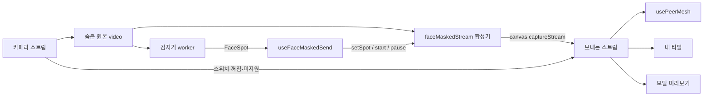

# 소셜룸 보내는 영상 얼굴 가림 설계 (BY-1092)

- 스토리: BY-1092, 하위 BY-1094(PLAN), BY-1095(DESIGN), BY-1096(FE)
- 시험판 기록: BY-1093, 설명 페이지 https://claude.ai/artifact/9QAbZXQfS4QUR5XVKRNoRK
- 기준 커밋: dev `d66660b5`

## 1. 목표

소셜룸에서 상대에게 보내는 영상 자체에 흐림과 이모지를 합성해, 사용자가 원하면 얼굴을 드러내지 않고 공부할 수 있게 한다.
싱글룸 미리보기 가림(BY-1069)은 내 화면에만 그리므로 상대가 받는 영상은 바뀌지 않는다.
그래서 보내는 트랙을 원본 카메라 트랙에서 합성한 캔버스 트랙으로 바꾼다.

이 작업은 포트폴리오 주제("2D 캔버스 합성을 WebGL로 바꿔 메인 스레드 비용을 없앤 개선")이기도 하다.
그래서 바꾸기 전과 후를 같은 조건으로 다시 측정할 수 있게 커밋을 나눈다(5절).

## 2. 동작

### 카메라 켜기 모달

- 제목 아래에 자물쇠 아이콘과 `같은 방에만 보이고 저장되지 않아요` 한 줄을 둔다. 기존 설명 `카메라를 켜면 순공시간 측정과 영상 공유가 시작돼요.`와 버튼 위 `영상은 서버에 저장되지 않아요.`를 합친 것이고, 창 설명(`DialogDescription`)으로 읽힌다.
- 미리보기 아래에 `얼굴 가리기` 스위치가 있고 기본값은 꺼짐이다. 오래 켜 두면 보급형 기기가 크게 뜨거워져(A23 60분 측정에서 과열 단계 3) 원하는 사람만 켜게 한다.
- 스위치가 켜져 있으면 그 아래에 이모지 후보가 가로로 나열되고, 고르면 미리보기에 바로 반영된다.
- 이모지는 개, 고양이, 곰, 햄스터, 원숭이, 판다, 토끼, 호랑이, 개구리 9개이고 Microsoft Fluent Emoji 3D(MIT)를 쓴다. 기본값은 개다.
- 이모지 줄은 한 줄을 유지하고 넘치는 이모지는 옆으로 넘겨 본다. 고른 이모지가 줄 밖에 있으면 창을 열 때 보이게 넘겨 둔다.
- 스위치가 꺼져 있으면 이모지 후보를 흐리게 보이고 고르지 못하게 막는다. 줄은 남겨 두어 켜고 끌 때 모달 높이가 바뀌지 않는다.
- `얼굴 가리기` 옆 안내 아이콘을 누르면 `빠르게 움직이면 얼굴이 잠깐 보일 수 있어요`를 툴팁으로 보여 준다.
- 모달이 열리면 첫 포커스는 취소 버튼에 둔다. 안내 아이콘에 먼저 가면 열리자마자 툴팁이 뜬다.
- 높이가 낮은 가로 화면에서는 미리보기를 왼쪽 칸, 나머지를 오른쪽 칸에 둔다. 한 줄로 쌓으면 스크롤해야 버튼이 보인다.
- 미리보기는 상대에게 실제로 보낼 영상이다.
- 사람을 찾는 동안 미리보기 가운데에 `가릴 위치를 찾고 있어요`를 표시한다(`role="status"`, reduced-motion이면 아이콘 회전을 멈춘다).
- 켬/끔과 고른 이모지는 기기에 저장되어 다음 입장 때도 유지된다.
- 합성을 쓸 수 없는 기기에서는 스위치를 꺼진 채 비활성화하고 `이 기기에서는 얼굴 가리기를 쓸 수 없어요`를 보여 준다.

### 세션 중 내 타일

- 내 타일에는 보내는 영상을 그대로 띄운다.
- 보이는 것과 보내는 것이 항상 같고, 이모지를 그리는 곳이 합성기 하나뿐이다.
- 대신 내 타일도 360p·15fps로 보이고 셀프뷰 밝기 보정 필터는 적용하지 않는다.
- 스위치가 꺼져 있으면 지금처럼 원본 카메라를 보정 필터와 함께 띄운다.

### 보내는 영상

| 상황                                             | 보내는 영상            |
| ------------------------------------------------ | ---------------------- |
| 사람을 아직 못 찾았거나 놓침                     | 전체 흐림              |
| 얼굴이 보임                                      | 이모지를 덮은 영상     |
| 이모지 이미지를 아직 못 불러옴                   | 전체 흐림              |
| 얼굴 모델이 두 번 연속 얼굴을 못 찾음(몸만 보임) | 이모지 없이 선명       |
| 스위치 꺼짐                                      | 원본, 합성 중지        |
| 카메라 꺼짐, 켜기 창 닫힘                        | 보내지 않음, 합성 중지 |

- 이모지 위치는 1~2초마다 갱신되므로 매 프레임 목표 위치로 15%씩 다가가게 해서 순간이동하지 않게 한다.
- 사라졌다 다시 나타날 때는 예전 자리에서 미끄러지지 않고 새 자리에 바로 놓는다.
- 흐림은 영상을 가로 24픽셀로 줄였다가 주변 픽셀과 섞으며 키워서 만든다.

### 감지기

- 입장할 때 카메라 스트림이 있으면 감지기 `preload()`로 모델만 미리 준비한다(추론은 하지 않는다).
- 세션이 일시정지인 동안 모달이 열려 있고 스위치가 켜져 있으면, 감지기는 `setPreviewOnly(true)`로 이모지 자리만 계산하고 자리 비움·휴대폰·졸음 신호는 내보내지 않는다.
- 추론이 멈추면 이모지 자리는 `null`이 되고 영상은 흐림으로 돌아간다.

## 3. 구조



| 파일                                             | 역할                                                                                                                                        |
| ------------------------------------------------ | ------------------------------------------------------------------------------------------------------------------------------------------- |
| `vision/faceSpot.ts`                             | 사람 검출 결과와 얼굴 범위로 이모지 자리(`FaceSpot`)를 계산한다. 시험판 코드를 그대로 쓰고 BY-1069도 나중에 같이 쓴다.                      |
| `vision/faceLandmarker.ts`                       | 결과에 얼굴 범위 `bounds`를 더한다.                                                                                                         |
| `adapters/focusDetector.ts`                      | `subscribeFaceSpot`, `setPreviewOnly`, `preload`를 더한다.                                                                                  |
| `live-room/faceMaskedStream.ts`                  | 합성기. 커밋 2는 2D, 커밋 3은 WebGL이고 외부 인터페이스는 같다.                                                                             |
| `live-room/faceMaskPlan.ts`                      | 무엇을 그릴지(흐림·이모지·선명) 정하는 함수와 이모지 따라가기 계산. 2D와 WebGL이 같이 쓴다.                                                 |
| `live-room/faceMaskSettings.ts`                  | 이모지 목록, 켬/끔과 고른 이모지의 저장.                                                                                                    |
| `live-room/useFaceMaskedSend.ts`                 | 합성기 생성, 이모지 자리 구독, 시작·정지, 보낼 스트림 선택, 원본 트랙 재활성화.                                                             |
| `live-room/components/CameraOnConfirmDialog.tsx` | 스위치, 이모지 선택(라디오 그룹), 미지원 안내.                                                                                              |
| `live-room/LiveRoomSession.tsx`                  | 숨은 원본 video, 훅 연결, 내 타일과 모달 미리보기.                                                                                          |
| `lib/amplitude.ts`                               | `social_room_face_mask_toggled`(`on`), `social_room_face_mask_emoji_selected`(`emoji_id`), `social_room_camera_toggled`에 `face_mask` 추가. |

### 합성기 인터페이스

```ts
interface FaceMaskedStream {
  readonly stream: MediaStream;
  setSpot(spot: FaceSpot | null): void;
  setSticker(url: string): void;
  start(): void;
  pause(): void;
  dispose(): void; // 송신 트랙 정지, WebGL 컨텍스트 해제
  stats(): FaceMaskedStreamStats; // 측정용
}

/** 캔버스 송신이나 그리기 컨텍스트를 만들 수 없으면 null. 호출부는 미지원으로 처리한다. */
function createFaceMaskedStream(video: () => HTMLVideoElement | null): FaceMaskedStream | null;
```

### 숨은 원본 video

- 추론과 합성은 화면 밖에 1px·투명으로 둔 원본 `<video>`를 본다.
- 카메라를 끄면 내 타일의 video가 사라지지만, 그동안에도 켜기 모달 미리보기에 이모지를 그려야 하기 때문이다.
- `display: none`이면 엔진이 영상 갱신을 멈출 수 있어 투명하게만 둔다.

### 원본 트랙 재활성화

- 원본으로 보내는 동안 일시정지하면 `usePeerMesh`가 원본 트랙을 `enabled = false`로 끈다.
- 그 트랙은 숨은 원본 video도 쓰므로, 가리기로 돌아오면 합성 재료가 검은 화면이 된다.
- 그래서 가리기가 켜져 있으면 `usePeerMesh` 효과 뒤에 원본 트랙을 다시 켠다. 가리는 동안 원본은 상대에게 가지 않는다.

### 모달 미리보기

- 원본과 가린 영상을 둘 다 재생해 겹쳐 두고, 스위치는 위쪽 레이어의 투명도만 바꾼다.
- 바꿀 때마다 `srcObject`를 새로 붙이면 iOS가 첫 프레임을 화면을 채우지 않은 채 그려 좌우 여백이 잠깐 보인다.

## 4. 오류 처리

| 상황                                                         | 동작                                                                                                                        |
| ------------------------------------------------------------ | --------------------------------------------------------------------------------------------------------------------------- |
| `captureStream` 없음, 컨텍스트 생성 실패, 셰이더 컴파일 실패 | 미지원. 스위치 비활성 + 안내, 원본 송신                                                                                     |
| 세션 중 WebGL 컨텍스트 끊김                                  | 새 프레임이 멈춰 상대에게는 마지막 가린 프레임이 남는다. `webglcontextrestored`에서 텍스처·셰이더를 다시 만들어 이어 그린다 |
| 이모지 이미지 로딩 실패                                      | 얼굴이 보여도 흐림                                                                                                          |
| AI 모델 로딩 실패                                            | 계속 흐림, `가릴 위치를 찾고 있어요` 유지. 원본은 사용자가 스위치를 끌 때만                                                 |
| `localStorage` 오류                                          | 기본값(꺼짐, 첫 번째 이모지)                                                                                                |

## 5. 성능 전후 비교

### 커밋 순서

1. 이모지 자리 계산과 감지기 API(테스트 포함).
2. 2D 합성으로 기능 전체 동작. **측정 해시 A.**
3. 합성기 내부만 WebGL로 교체. **측정 해시 B.**
4. 이모지 선택 UI와 이모지 파일.
5. 미지원 안내, 설계 문서 §8 예외, 측정 기록.

- 커밋 2와 3 사이에는 `faceMaskedStream.ts`만 바뀐다. 판단 로직(`faceMaskPlan.ts`)과 측정 통계는 같다.
- 가림 없음 조건은 dev `d66660b5`로 측정한다.
- 이모지 파일이 측정보다 늦게 오면 커밋 2·3은 기존 `face-sticker.png`를 측정용으로 쓴다. 한 장짜리 텍스처라 성능 차이가 없고 커밋 4에서 교체한다.

### 가설과 실험

| #   | 가설                                                                                                                      | 실험                                                                                                                                                                     |
| --- | ------------------------------------------------------------------------------------------------------------------------- | ------------------------------------------------------------------------------------------------------------------------------------------------------------------------ |
| H1  | A23 웹뷰의 2D 캔버스는 CPU로 그려서, 매 프레임 GPU 쪽 카메라 프레임을 CPU 메모리로 복사한다. 그 복사가 80ms의 대부분이다. | A23 Chrome `chrome://gpu`의 Canvas 항목 확인. 커밋 2 위에서 기본 2D, `willReadFrequently: true` 2D, `ImageBitmap` 그리기의 시간을 비교한다(측정 코드는 커밋하지 않는다). |
| H2  | WebGL은 15fps를 보내면서도 발열과 소비 전력이 2D보다 같거나 낮다.                                                         | 세 조건 × 두 기기 20분 측정                                                                                                                                              |
| H3  | iPhone에서도 2D가 WebGL보다 느리다.                                                                                       | 같은 측정                                                                                                                                                                |

### 측정 도구

- `window.__faceMaskStats()`는 개발 빌드와 `VITE_FACE_MASK_STATS=1`로 만든 측정 빌드에서만 열리고, 초당 합성 횟수, 프레임당 영상 그리기 시간과 이모지 그리기 시간, 캔버스 높이를 돌려준다.
- 받는 쪽 `inbound-rtp`의 `framesPerSecond`로 실제로 전달된 fps를 함께 기록한다.
- A23 수집 스크립트는 adb로 온도·발열 단계·CPU·전류·전압을, Chrome DevTools로 위 통계를 주기적으로 기록한다.
- iPhone은 설정의 Performance Trace로 기록해 Instruments로 연다.
- 측정 기준, 커밋 해시, 결과 표는 BY-1094 측정 문서에 둔다.

## 6. 개인정보

- 합성은 단말 안에서만 한다.
- 얼굴 위치 좌표는 화면 그리기와 송신 합성에만 쓰고 로그, 분석 이벤트, 서버로 보내지 않는다.
- 진단 로그 타입(`diagnostics.ts`)이 좌표를 받지 않는 상태를 유지한다.
- 비전 파이프라인 설계 문서 §8에 이 예외를 적는다.

## 7. 테스트

- `faceSpot`: 시험판 테스트를 가져온다.
- `focusDetector`: 추론 정지 시 자리 `null`, 미리보기 전용일 때 세션 신호 차단, `preload` 1회 준비.
- `faceMaskSettings`: 기본값, 목록에 없는 저장값은 첫 번째 이모지, 저장소 오류.
- `faceMaskPlan`: 그릴 내용 판단, 따라가기 계산, 재등장 시 바로 놓기.
- `useFaceMaskedSend`: 켬·끔·미지원별 보낼 스트림, 스위치와 카메라 상태에 따른 시작·정지, 언마운트와 StrictMode 재마운트 때 해제, 원본 트랙 재활성화.
- `CameraOnConfirmDialog`: 스위치, 켰을 때만 보이는 이모지 라디오 그룹, 미지원 안내, 접근성 이름.
- GPU 그리기 자체는 jsdom에서 돌릴 수 없어 실기기로 확인한다.

## 8. 범위 밖

- 뒷모습만 보일 때의 처리는 보류한다.
- 배경 흐림은 하지 않는다.
- 싱글룸 미리보기와 타임랩스의 이모지 선택은 하지 않는다(BY-1069, 타임랩스는 `face-sticker.png` 유지).
- 추론 주기(`FRAME_INTERVAL_MS` 1000)와 추론 delegate는 바꾸지 않는다(GPU 추론은 BY-1098).
