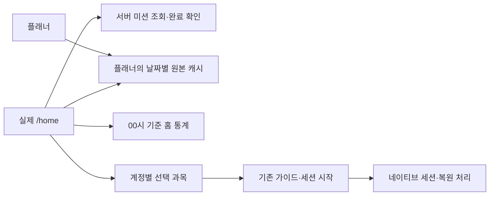

# 홈 v3 프론트엔드 구현 현황

작성: 2026-11-07. 갱신: 2026-11-08. [BY-1188](https://breathless-youth.atlassian.net/browse/BY-1188)과 FE 하위 작업 [BY-1189](https://breathless-youth.atlassian.net/browse/BY-1189)의 구현이다. 토큰을 받는 앱의 `/home`은 새 홈을 기본으로 표시한다. dev 대상 PR은 `8ff460f0`의 플래너 후속 변경과 통합한다. 서버 구현과 운영 배포는 이 PR의 범위 밖이다.

## 확인하는 방법

저장소의 Node 24 이상과 pnpm 10.28.2를 사용한다.

```sh
pnpm install --frozen-lockfile
pnpm --filter web dev --port 5199 --host 127.0.0.1
```

실제 진입점은 `/home`이다. 인증 없이 시안 상태만 비교하려면 `/dev/home-v3?lang=ko`를 연다. 상단에서 2a~2h와 라이트·다크를 고르고 `capture=1`로 조작 줄을 숨긴다. 이 경로와 메모리 데이터는 production 빌드에서 제외한다. 미리보기는 실제 계정·미션·목표 저장 검증을 대신하지 않는다.

## 실제 연동



미션은 `GET /api/home/mission`과 `POST /api/home/mission/steps/{step}/complete`를 사용한다. 서버의 `currentStep`·`eligible`을 표시하고 완료 요청 성공 뒤에만 다음 단계로 전환한다. 같은 버전의 늦은 조회가 완료 단계를 되돌리지 않게 캐시를 비교한다. 목표를 먼저 조회해 마지막 미션 완료 직후 저장된 목표를 표시한다.

2단계는 `startsOn` 이후 현지 달력 날짜 하루의 원본 MEASURED 순공 합계 300초가 기준이다. 같은 날의 여러 세션은 합산하고 서로 다른 날짜·수동 기록은 합산하지 않는다. `measuredFocusSec`은 인정되는 날짜별 합계 중 최댓값이다. FE가 홈 통계로 자격을 다시 계산하지 않는다.

홈과 플래너는 계정·날짜·시간대별 `PlannerDayResponse` 캐시를 공유한다. 홈의 날짜 목표 저장에만 `calendar=HOME`을 전달한다. 홈 통계·진행률은 00시 기준이고 플래너의 기존 05시 기준은 유지한다. `null`과 명시적 `0`을 구분하며 날짜 목표 0을 삭제하거나 기본 목표로 대체하지 않는다. 날짜 저장 후 기본 목표만 실패하면 기본 목표만 재시도한다.

목표 입력은 홈과 플래너가 `GoalDurationInput`을 공유한다. 0~24시간 범위에서 30분씩 조절하고 4·6·8·10시간 빠른 선택을 제공한다. 저장된 36,900초 같은 값은 열기·저장에서 보존하며 증감은 정확히 1,800초다. 기본 목표 스위치의 화면별 초기값은 유지한다. 날짜·시간대가 바뀌면 시트를 닫고 진행 중인 저장은 편집을 시작한 날짜에 적용한다.

마지막 과목과 명시적 `과목 없음`은 계정별 기기 저장소에 보관한다. 조회 실패로 선택을 지우지 않고 삭제가 확인된 과목만 해제한다. 선택 과목은 첫 가이드와 실제 시작 요청까지 전달하며 기존 세션 복원 과목이 우선한다. 지원하지 않는 구 앱에는 업데이트를 안내한다. 비동기 저장·시작 전후 계정이 바뀌면 이전 계정 작업을 중단한다.

## 화면과 기존 기능

파란 시계와 노트 원본·로컬 SVG를 사용한다. 시계는 과목과 관계없이 파란색이고 이름 앞 점에만 과목색을 적용한다. D-Day·통계·타임랩스·앱 잠금·분석 효과·사전 로딩을 재사용한다. 네이티브 셸은 탭바·권한·세션 스택을 계속 담당한다.

공지 → 세션 복구 → 미완료 할 일 순서를 유지하고 목표 시트·과목 메뉴와 겹치지 않게 한다. 앱 가시성을 `app-visibility`로 전달해 문서가 계속 visible인 Android에서도 홈 복귀 시 재조회한다. 탭 이동과 앱 가시성은 구분해 권한 창에서 첫 가이드를 닫지 않는다.

좁은 화면에서 과목 버튼이 시계를 가리던 문제를 수정했다. 과목명은 최대 12자도 한 줄과 말줄임표를 유지한다. 폰 시계는 190px이고 패드는 화면 너비 768px 이상 260px, 1024px 이상 280px이다. 공통 `page-column`과 같은 최대 640/720px 열을 미리보기에도 적용한다. 패드 예시 화면은 실제 iPad QA로 집계하지 않는다.

## API 기준

BE 기준은 [PR #156](https://github.com/breathless-youth/backend/pull/156)의 `17ae022c67214b42b206a6e769bfa7bd9bccbbe1`과 배포 Swagger다. 목표는 [BE PR #144](https://github.com/breathless-youth/backend/pull/144)의 기존 계약을 재사용한다. 자세한 경로와 인정 규칙은 [백엔드 연동 확인](2026-11-07-home-v3-backend-requests.md)에 있다.

## 이전 구현에서 확인한 범위

아래는 dev 통합 전 `b7b86d61` 기반 변경에서 확보한 근거다. 최종 통합 코드의 실기기 통과로 바꾸어 세지 않는다.

- 자동 검사: 웹 520파일·7,227개 통과·기존 제외 1개, 모바일 103스위트·1,714개 통과, 타입·린트·웹 빌드 통과다. 당시 Node 22.14.0의 저장소 요구 버전 경고가 있었다.
- 브라우저 fixture: 8상태×라이트·다크 16장, 4개 언어와 작은 화면·태블릿 배치, Escape·초점 복귀·터치 영역·reduced-motion을 확인했다. 실제 API·기기 검증과 구분한다.
- Android 실기기: 당시 90항목 중 42항목(통과 35·수정 후 통과 7)을 확인했다. 카메라 거부·복원, 실제 제출, 과목 없이 제출, 실제 체크포인트 과목 복원과 같은 홈 복귀 재조회를 포함한다.
- iPhone 실기기: 현재 95항목 중 통과 65·수정 후 통과 2로 **67개를 확인**했다. 조건 차단 27·미실행 1로 **28개는 남아 있다**. 기존 과목 인정, 실측 356초 제출 후 미션 완료·목표 안내, 목표 입력·저장·부분 실패 재시도·연속 탭 차단·플래너 연동과 실제 체크포인트 복원을 포함한다.

실제 개발 API로 1단계 완료·중복 완료의 멱등성·미충족 2단계 400, 날짜 목표 0과 기본 목표 우선순위를 확인했다. 초기 브라우저 목표 편집 검증의 미션 응답만 fixture였고 이후 iPhone에서는 원본 MEASURED의 같은 날 순공 506초와 실제 2단계 완료·목표 전환을 확인했다. 실제 저장 성공을 홈 합계 증가나 다른 기기 동기화의 증거로 바꾸어 말하지 않는다.

## 남은 실기기 확인과 한계

- iOS Larger Text를 기본→최대→기본으로 바꾸었을 때 배치는 안정적이었다(UI-04).웹의 고정 14px 글자 자체가 시스템 설정에 따라 커지는지는 확인하지 못했다.
- 카메라 OFF→거부 안내→ON 원복과 활성 세션 404는 부분 확인했다. 새 설치의 최초 권한 prompt와 허용 후 실제 측정은 아직 검증하지 않았다.
- VoiceOver는 사용자 요청으로 보류했다. 재설치·다른 기기 동기화·실제 iPad·실제 자정 등 남은 조건은 통과로 표시하지 않는다.
- UI-09는 입력만 확인했고 저장하지 않았다. 오늘·기본 목표의 `null`은 보존했다. 목표 100% 예시 화면은 미리보기이며 실제 계정 변경이나 API 요청을 하지 않았다.
- 실제 복원은 WebView 재로드 뒤 같은 시작 시각·복원 과목 유지와 제출 성공을 확인한 흐름이다. 미소비 URL 초기 과목과 복원 과목이 동시에 남는 별도 분기는 검증하지 않았다.
- 실제 기록에서 전체 순공 49초와 과목 합계 51초 차이를 확인했다. 원인은 BE splitter의 조기 정수 절삭으로 격리 재현했다. FE가 응답을 임의 보정하지 않는다. 수정 후보는 별도 검토 자료이며 이 PR에 BE 코드·서버 적용·배포는 없다.

카메라 원본·얼굴·랜드마크·인증 정보·장치 식별자는 공유 자료와 제품 커밋에 포함하지 않는다. 로컬 QA 도구·앱 사본·캡처·로그도 PR에 포함하지 않는다. 원래 개발 계정과 기존 기록은 보존한다.

관련 문서: [설계](2026-11-07-home-v3-design.md), [백엔드 연동 확인](2026-11-07-home-v3-backend-requests.md).
