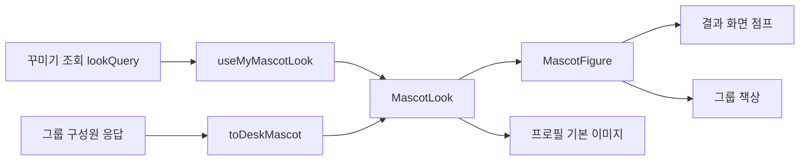

# 공통 캐릭터 부품 설계

## 목표

사용자가 고른 마스코트와 끼고 있는 소품을 부품 하나로 그려서 결과 화면, 프로필, 그룹 책상이 같은 모습을 보이게 했다. 멀티룸과 랭킹은 서버가 필드를 주면 바로 그릴 수 있게 자리를 만들었다.

## 구조

- `components/mascot/types.ts`에 `MascotId`, `AccessorySlot`(7칸), `WornAccessory`, `MascotLook`을 두었다.
- `components/mascot/mascotLayers.ts`가 겹치는 순서를 한 곳에서 정한다.
- `components/mascot/MascotFigure.tsx`가 몸 뒤 소품, 몸, 몸 앞 소품 순서로 같은 정사각형 상자에 겹친다.
- `features/points/model/useMyMascotLook.ts`가 꾸미기 조회(`GET /api/decorations`)에서 내 모습을 읽는다.

## 결정

- 소품 그림은 마스코트 정지 그림과 같은 판 크기의 투명 그림이라 위치 좌표를 두지 않았다.
- 겹치는 순서는 뒤에서 앞으로 발밑, 날개, 몸, 몸 소품, 얼굴, 머리, 물건, 효과다.
- 서버가 칸마다 그림 한 장만 주어서 머리와 효과의 뒤 조각은 아직 그리지 않는다. 뒤 조각이 생기면 `mascotLayers.ts`의 `BEHIND`에 더한다.
- 몸을 다르게 그리는 화면은 `MascotFigure`의 `body`로 몸 자리를 채운다. 불리언 옵션을 늘리지 않으려고 조각을 넘기는 방식을 골랐다.
- 내 모습은 상점 응답이 아니라 꾸미기 조회에서 읽는다. 상점 상품이 늘어도 받는 양이 그대로이고 그룹 구성원 응답과 같은 모양이라 변환(`toMascotLook`)을 함께 쓴다. 상점에서 마스코트나 소품을 바꾸면 이 조회를 무효화해 다른 화면도 따라 바뀐다.
- 포인트 기능이 꺼져 있거나 꾸미기를 받지 못하면 모습이 `null`이고 모든 화면이 지금처럼 타이미를 그린다.
- 결과 화면의 표정 그림 4장은 타이미(스톱워치)만 있다. 표정 그림은 소품 그림과 판 크기가 달라서, 다른 마스코트이거나 소품을 끼고 있으면 정지 그림으로 뛰어오른다.
- 프로필 기본 이미지도 고른 마스코트를 소품과 함께 그린다. 랭킹과 멀티룸 아바타는 같은 모습(`look`)을 선택 prop으로 받는다.
- 멀티룸 타일과 랭킹 아바타는 `mascot` prop만 받게 했다. Swagger에 필드가 없어 타입과 연결은 만들지 않았다.

## 세션 캐릭터 연결 방법

싱글 세션 화면 개편이 dev에 들어오면 `SessionMascot`을 이렇게 바꾼다.

- 9칸 표정 그림이 있는 마스코트는 `MascotFigure`의 `body`에 지금의 시트 조각을 넣는다. 시트 한 칸의 판 크기를 소품 그림과 맞춰야 소품이 맞는다.
- 9칸 그림이 없는 마스코트는 `body` 없이 `MascotFigure`를 그려 표정 없이 고른 모습을 보인다.
- 자리를 비운 상태의 실루엣 칸에서는 소품을 그리지 않는다.

## 남은 일

- 서버의 새 칸 코드(`WINGS`, `HELD`, `UNDERFOOT`, `EFFECT`)는 웹에서 먼저 정한 이름이라 백엔드와 맞춰야 한다.
- 상점의 칸 고르기 칩은 아직 머리, 얼굴, 몸 세 개만 보인다.
- 6종의 표정 그림이 나오면 `FRAMES_BY_MASCOT`에 더한다.
