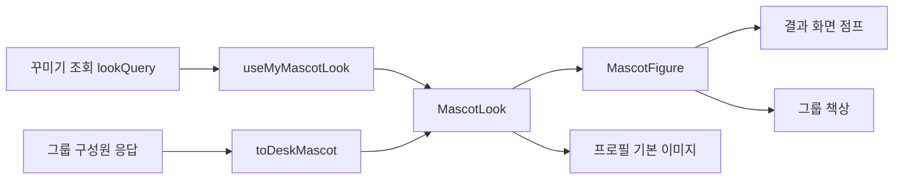

# 공통 캐릭터 부품 설계

## 목표

사용자가 고른 마스코트와 끼고 있는 소품을 부품 하나로 그려서 결과 화면, 프로필, 그룹 책상이 같은 모습을 보이게 했다. 멀티룸과 랭킹은 서버가 필드를 주면 바로 그릴 수 있게 자리를 만들었다.

## 구조

- `components/mascot/types.ts`에 `MascotId`, `AccessorySlot`(7칸), `WornAccessory`, `MascotLook`을 두었다.
- `components/mascot/mascotLayers.ts`가 겹치는 순서를 한 곳에서 정한다.
- `components/mascot/MascotFigure.tsx`가 몸 뒤 소품, 몸, 몸 앞 소품 순서로 같은 정사각형 상자에 겹친다.
- `features/points/model/useMyMascotLook.ts`가 꾸미기 조회(`GET /api/decorations`)에서 내 모습을 읽는다.

## 결정

- 소품 그림은 마스코트 정지 그림과 같은 판 크기의 투명 그림이라 위치 좌표를 두지 않았다.
- 겹치는 순서는 뒤에서 앞으로 효과 뒤 그림, 발밑, 날개, 나머지 칸의 뒤 조각, 몸, 몸 소품, 날개 앞 조각, 발밑 앞 조각, 얼굴, 머리, 물건, 효과다.
- 발밑과 날개는 본체가 몸 뒤에 있는 칸이다. `backImageUrl`이 없으면 `imageUrl`을 몸 뒤에 그리고, `backImageUrl`이 있으면 그 그림이 본체라 몸 뒤에, `imageUrl`은 끈이나 앞발 같은 앞 조각이라 몸 앞에 그린다.
- 나머지 칸은 `imageUrl`이 본체이고, 목도리처럼 몸을 감싸는 소품만 `backImageUrl`로 뒤 조각을 받아 몸 뒤에 그린다.
- 날개 앞 조각과 발밑 앞 조각이 몸 소품 바로 다음에 오는 것은 프론트가 정한 순서다. 끈이 옷 위로 지나가게 하려는 것이고, 그림을 보고 바꿀 수 있다.
- 몸을 다르게 그리는 화면은 `MascotFigure`의 `body`로 몸 자리를 채운다. 불리언 옵션을 늘리지 않으려고 조각을 넘기는 방식을 골랐다.
- 내 모습은 상점 응답이 아니라 꾸미기 조회에서 읽는다. 상점 상품이 늘어도 받는 양이 그대로이고 그룹 구성원 응답과 같은 모양이라 변환(`toMascotLook`)을 함께 쓴다. 상점에서 마스코트나 소품을 바꾸면 이 조회를 무효화해 다른 화면도 따라 바뀐다.
- 포인트 기능이 꺼져 있거나 꾸미기를 받지 못하면 모습이 `null`이고 모든 화면이 지금처럼 타이미를 그린다.
- 결과 화면의 표정 그림 4장은 타이미(스톱워치)만 있다. 표정 그림은 소품 그림과 판 크기가 달라서, 다른 마스코트이거나 소품을 끼고 있으면 정지 그림으로 뛰어오른다.
- 프로필 기본 이미지도 고른 마스코트를 소품과 함께 그린다. 랭킹과 멀티룸 아바타는 같은 모습(`look`)을 선택 prop으로 받는다.
- 멀티룸 타일과 랭킹 아바타는 `mascot` prop만 받게 했다. Swagger에 필드가 없어 타입과 연결은 만들지 않았다.

## 세션 캐릭터 연결 방법

싱글 세션 화면 개편이 dev에 들어오면 `SessionMascot`을 이렇게 바꾼다.

- 9칸 표정 그림이 있는 마스코트는 `MascotFigure`의 `body`에 지금의 시트 조각을 넣는다. 시트 한 칸의 판 크기를 소품 그림과 맞춰야 소품이 맞는다.
- 9칸 그림이 없는 마스코트는 `body` 없이 `MascotFigure`를 그려 표정 없이 고른 모습을 보인다.
- 자리를 비운 상태의 실루엣 칸에서는 소품을 그리지 않는다.

## 남은 일

- 서버의 새 칸 코드(`WINGS`, `HELD`, `UNDERFOOT`, `EFFECT`)는 웹에서 먼저 정한 이름이라 백엔드와 맞춰야 한다.
- 상점의 칸 고르기 칩은 아직 머리, 얼굴, 몸 세 개만 보인다.
- 6종의 표정 그림이 나오면 `FRAMES_BY_MASCOT`에 더한다.

## 2026-11-16 추가: 넓은 소품 판, 세트, 효과 움직임

백엔드 dev `3b8f395` 기준이다.

### 소품 판

- 마스코트 판 한 변을 1024로 볼 때 소품·세트 그림 판은 사방으로 208씩 넓은 1440이다.
- `MascotFigure`의 상자는 지금처럼 마스코트 판 크기다. 소품 그림은 상자보다 사방으로 20.3125% 넓게 그려 상자 밖으로 나간다.
- 그래서 쓰는 화면의 마스코트 크기는 바뀌지 않는다. 소품이 잘리면 안 되는 화면은 둘레에 그만큼 여백을 둔다.
- 서버는 판 규격을 필드로 주지 않는다. 값은 `mascotLayers.ts`의 `ACCESSORY_BOARD_OUTSET` 한 곳에 있고, 그림을 만드는 쪽(`accessory-samples/extract_layer.py`의 `PAD`)과 같아야 한다.

### 세트

- 착용 칸 `SET`은 낱개 일곱 칸과 함께 끼지 않는다. 서버가 한 요청에서 반대쪽을 벗기고 바뀐 꾸미기 전체를 돌려준다.
- 세트를 입으면 뒤 조각, 몸, 옷, 효과 그림 순서로 그린다. 낱개 소품이 함께 와도 그리지 않는다.
- 세트 그림이 마스코트까지 그린 완성 그림으로 바뀌면 `HIDE_MASCOT_UNDER_SET`을 true로 바꾼다.
- 세트는 스토어 결제로만 산다. 상점에서는 소품 화면의 맨 앞 칩이다.

### 효과

- `effectPieces`가 있으면 효과 그림을 조각마다 잘라 `motion`대로 움직인다. 효과 칸 소품은 `imageUrl`에, 세트는 `effectImageUrl`에 적용한다.
- 아는 움직임은 float, fall, rise, twinkle, flutter, pulse, sway, bob, pop이다. 모르는 이름은 멈춘 조각으로 그린다.
- 조각 정보가 없는 효과 그림은 통째로 떠오르내린다.
- 오라나 뒤 배경 같은 효과는 `imageUrl` 없이 `backImageUrl`만 온다. 이때는 뒤 그림을 가장 뒤에 그리고 `effectPieces`와 떠오르내림을 뒤 그림에 적용한다. 두 그림이 다 오면 움직임은 앞 그림만 맡고 뒤 그림은 멈춰 있다.
- 상점 칸과 소품 격자는 `imageUrl`이 없으면 `backImageUrl`을 보여 준다.
- `effectType`이 aurora, glow, rainbow면 그림 없이 마스코트 윤곽을 가림막으로 써서 몸 뒤에 빛을 그린다. 모르는 종류는 그리지 않는다.
- 모든 움직임은 모션 축소를 켜면 멈춘다.

### 다른 사람의 모습

- 랭킹 줄과 멀티룸 멤버의 `mascot`을 `toOthersMascotLook`으로 바꿔 아바타에 넘긴다.
- 서버는 고른 적이 없는 사람에게도 첫 마스코트를 실어 보낸다. 포인트를 열지 않은 곳에서는 지금 기본 그림이 그대로 보이게 null을 준다.
