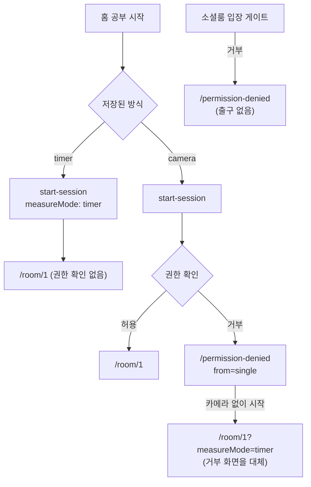

# BY-1326 앱: 카메라 권한 확인 건너뛰기와 거부 화면 출구

## 배경

BY-1323·1324에서 홈이 측정 방식(카메라·카메라 없이)을 기기에 기억하고, 세션 화면이 그 값으로 카메라를 열지 정하게 됐다. 그런데 앱은 `start-session`을 받으면 방식과 상관없이 카메라 권한부터 확인한다. 그래서 카메라 없이 고른 사용자도 OS 권한 창을 보고, 거부하면 막다른 거부 화면에 갇힌다. 위키 policies §3은 2026-07-26부터 권한 거부 시 수동 타이머를 제공하기로 정해 두었다.

## 결정 (2026-11-18 사용자 승인)

| #   | 항목                         | 결정                                                                                                                                                                                            |
| --- | ---------------------------- | ----------------------------------------------------------------------------------------------------------------------------------------------------------------------------------------------- |
| 1   | 앱이 방식을 아는 방법        | `start-session`에 선택 필드 `measureMode: "timer"`를 더한다. 값이 있으면 앱은 권한 확인을 건너뛴다. 구버전 앱은 모르는 필드를 버려 지금처럼 권한을 확인하고, 세션 화면은 저장된 방식대로 열린다 |
| 2   | 거부 화면 버튼 위계          | `설정 열기`(주) 아래에 `카메라 없이 시작`(보조), 그 아래 `홈으로 돌아가기` 링크를 둔다                                                                                                          |
| 3   | 출구 동작                    | 거부 화면을 세션 화면으로 바꿔 연다. 웹 주소에 `measureMode=timer`를 붙이고, 세션 화면은 이 값을 저장값보다 먼저 본다. 고르려던 과목도 넘긴다                                                   |
| 4   | 저장된 방식                  | 출구로 연 세션은 기기에 저장된 방식도 `timer`로 바꾼다                                                                                                                                          |
| 5   | 소셜룸 입장에서 연 거부 화면 | 출구를 보이지 않는다                                                                                                                                                                            |
| 6   | 본문 문구                    | 유지한다                                                                                                                                                                                        |
| 7   | 버튼 문구                    | ko `카메라 없이 시작`, en `Start without camera`, ja `カメラなしで始める`, zh-Hant `不用相機開始`                                                                                               |
| 8   | 분석 이벤트                  | `permission_denied_left`의 `reason`에 `start_without_camera`를 더한다                                                                                                                           |
| 9   | 시안                         | V3 파일 섹션 `12097:21218`(라이트 `12097:21219`, 다크 `12097:21270`)                                                                                                                            |

## 흐름

## 변경

### 공용 타입 (`packages/types/src/bridge.ts`)

- `start-session`에 `measureMode?: "timer"`를 더한다. 카메라 방식은 필드를 싣지 않는다. 필드가 없을 때가 지금 동작이라, 구버전 웹·앱과 값이 어긋나지 않는다.

### 웹

- `requestSessionStart`가 저장된 방식이 `timer`이면 `start-session`에 `measureMode: "timer"`를 싣는다.
- `RoomPage`는 주소의 `measureMode=timer`를 저장된 방식보다 먼저 본다. 이어받은 세션의 `source`는 여전히 가장 먼저 본다.
- 주소에 `measureMode=timer`가 있으면 저장된 방식도 `timer`로 바꾼다.

### 앱

- `webBridge`의 `start-session` 파서가 `measureMode`를 `"timer"`일 때만 통과시킨다. 다른 값은 그 필드만 버린다.
- `nativeBridgeHandler`는 `measureMode === "timer"`이면 권한 확인 없이 세션 화면을 연다. 연타 잠금은 지금과 같다.
- 권한 거부로 거부 화면을 열 때 `from=single`과 과목을 함께 넘긴다. 소셜룸 게이트는 지금처럼 파라미터 없이 연다.
- 거부 화면은 `from=single`일 때만 `카메라 없이 시작`을 그린다. 누르면 `router.replace`로 세션 화면을 열어서, 세션을 닫으면 홈으로 돌아온다.
- 출구로 연 세션도 연타 잠금을 걸고 세션 화면이 닫힐 때 푼다.
- 세션 화면(`app/room/[id].tsx`)은 `measureMode=timer`를 웹 주소로 넘긴다.
- 보조 버튼은 `PrimaryCtaButton`과 같은 52px·모서리 16에 보조 색을 쓴다. 시안의 버튼 높이(56px)와 앱의 차이는 원래 있던 차이라 이번에 맞추지 않는다.

## 호환

| 웹        | 앱        | 결과                                                                                                                      |
| --------- | --------- | ------------------------------------------------------------------------------------------------------------------------- |
| 새 웹     | 구버전 앱 | 앱이 `measureMode`를 버려 권한을 확인한다. 허용하면 세션 화면이 저장된 `timer`로 열린다. 거부하면 출구 없는 거부 화면이다 |
| 새 웹     | 새 앱     | 권한 확인을 건너뛰고 카메라 없이 열린다                                                                                   |
| 구버전 웹 | 새 앱     | 웹이 배포를 먼저 하므로 생기지 않는다                                                                                     |

## 범위 밖

- 스토어 배포와 앱 버전 올리기.
- 위키 policies §3·voice-tone §4 반영은 BY-1328에서 한다.
- 시안과 앱의 거부 화면 수치 차이(버튼 높이, 글자 크기)를 맞추는 일.

## 검증

- 단위 테스트: 파서, 핸들러 분기, 거부 화면 출구, 웹 시작 메시지, 세션 화면 방식 판단.
- 실기기: iOS(iPhone 13 mini)와 Android에서 카메라 없이 시작할 때 권한 창이 뜨지 않는지, 거부 화면 출구로 세션이 열리는지, 세션을 닫으면 홈으로 돌아오는지 확인한다.
