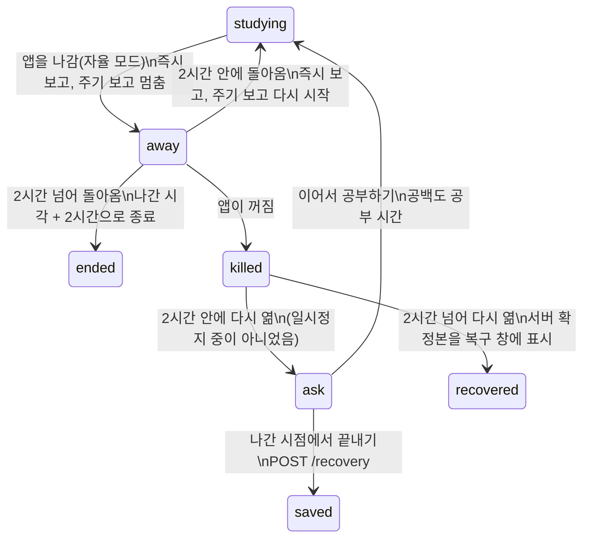

# BY-1357 웹 자율 모드 백그라운드 유지 설계

## 배경

- 자율 모드(`source = TIMER`)는 카메라를 쓰지 않는데도 화면이 꺼지거나 앱 밖으로 나가면 관리 모드처럼 일시정지했다.
- 그래서 휴대폰을 잠가 두고 공부하면 시간이 기록되지 않았다.
- 정책은 위키 `product/specs/BY-1354-자율-모드-백그라운드.md`에 있고, 서버는 BY-1356에서 자율 모드 진행 기록을 보고가 끊긴 뒤 2시간 동안 확정하지 않게 바꿨다.
- 이 문서는 웹이 맡는 부분만 다룬다.

## 결정 (2026-11-20 사용자 승인, 모두 추천안)

| 번호 | 항목                                | 결정                                                                                                      |
| ---- | ----------------------------------- | --------------------------------------------------------------------------------------------------------- |
| 1    | 이어서 공부할지 묻는 자리           | 앱 실행 직후 홈과, 방 화면이 새로 열려 복원할 때 두 곳에서 묻는다                                         |
| 2    | 브라우저로 홈을 다시 열었을 때      | 지금처럼 묻지 않는다. 실행 직후 복구는 앱에서만 돈다                                                      |
| 3    | `나간 시점에서 끝내기` 뒤           | 확인 창만 닫는다. 방에서 고른 경우는 홈으로 돌아간다                                                      |
| 4    | 직접 일시정지한 채 앱이 꺼졌을 때   | 묻지 않고 지금처럼 처리한다                                                                               |
| 5    | 앱 밖에서 뽀모도로 구간이 끝났을 때 | 돌아온 시점에 휴식을 시작하거나 끝낸다. 정확한 시각 기록은 후속으로 미룬다                                |
| 6    | 확인 창의 `{N}분`                   | 분 단위로 내림하고 최소 1분으로 보인다                                                                    |
| 7    | 분석 이벤트                         | 확인 창 이벤트 2개를 더하고, 2시간 초과 자동 종료는 `study_session_ended`의 `end_reason`에 새 값을 더한다 |
| 8    | 확인 창 시안                        | 기존 복구 창과 같은 모양으로 먼저 만들고 Figma에 반영한다. BY-1358 시안이 나오면 맞춘다                   |

## 지금 동작

- `systemPauseSource`가 `visibilitychange`·`pagehide`로 앱을 나간 것을 알리면, `useStudyRoomSession`이 두 모드 모두 `pause("BACKGROUND")`를 부른다.
- 공부 시간은 벽시계 구간(`sessionTimeline`)으로 계산하므로, 일시정지하지 않으면 앱 밖 시간이 저절로 공부 시간에 들어간다.
- 진행 보고는 30초마다 나가고 화면이 숨었는지는 따지지 않는다.
- 앱을 켜면 `useLaunchSessionRecovery`가 `POST /recovery`로 남은 진행 기록을 바로 확정하고, 순공이 1분 이상이면 홈에 복구 창을 띄운다.
- 방 화면이 새로 열리면 `useActiveSessionRestore`가 `GET /active`로 진행 기록을 받아, 공백을 `BACKGROUND` 일시정지로 열어 이어받는다.
- `POST /recovery`는 아직 보여 주지 않은 자동 확정본도 돌려준다. 그래서 서버가 2시간 뒤 확정한 세션도 다음 실행 때 복구 창에 나온다.

## 흐름

## 변경

### 세션 훅 (`useStudyRoomSession`)

- 자율 모드는 `onLeave`에서 `pause("BACKGROUND")`를 부르지 않고 나간 시각(`awayFromMs`)만 적는다.
- 나갈 때 진행 기록을 바로 한 번 보고한다. 페이지가 닫혀도 요청이 끝까지 가도록 `keepalive`를 건다.
- 앱 밖에 있는 동안은 30초 주기 보고를 보내지 않는다. 서버가 마지막 보고 시각을 나간 시각으로 기억해야 돌아오지 않은 세션이 그 시각으로 확정된다.
- 돌아왔을 때 나간 지 2시간이 안 됐으면 나간 시각을 지우고 바로 한 번 보고한 뒤 주기 보고를 다시 시작한다. 나가는 보고가 아직 끝나지 않았어도 기다리지 않고 보낸다. `keepalive`는 걸지 않는다.
- 돌아왔을 때 나간 지 2시간이 넘었으면 `나간 시각 + 2시간`을 종료 시각으로 세션을 끝낸다.
- 브라우저 탭은 숨어 있어도 타이머가 느리게 돈다. 그래서 2시간이 되는 순간에도 같은 종료를 한 번 시도하고, 돌아왔을 때 다시 확인한다.
- 종료 시각을 지정할 수 있게 `endAndSubmit`이 종료 시각을 선택 인자로 받는다. 지금의 `Date.now()` 고정은 인자가 없을 때만 쓴다.
- 지정한 종료 시각보다 늦게 시작한 구간은 타임라인에서 잘라 낸다. 앱 밖에서 뽀모도로가 휴식으로 넘어간 경우가 여기에 해당한다(`sessionTimeline`에 자르는 함수를 더한다).
- 직접 누른 일시정지와 휴식 중에 앱을 나가면 상태 전이는 지금처럼 한다(직접 누른 일시정지는 그대로, 휴식은 일시정지로 끊는다). 2시간 상한은 걸지 않고 20분 자동 종료가 그대로 맡는다.
- 이때도 자율 모드는 나갈 때 그 일시정지 상태로 한 번 보고하고 앱 밖에서는 주기 보고를 멈춘다. 돌아오면 바로 한 번 보고한다. 앱이 꺼져도 마지막 보고가 일시정지로 끝나서 다시 열 때 묻지 않는다.
- 앱 밖에 있는지와 2시간 상한을 재는 나간 시각을 따로 둔다. 나간 시각은 공부하던 채 나갔을 때만 적는다.
- 관리 모드는 바꾸지 않는다.

### 종료 사유와 안내

- `SessionEndReason`의 자동 종료 트리거에 `AWAY_LIMIT`을 더한다.
- `AutoEndNotice`는 이 트리거일 때 본문으로 `앱 밖에 2시간 넘게 있어서 2시간까지 기록하고 공부를 마쳤어요`를 보여 준다. 제목 `여기까지 기록을 저장했어요`와 `결과 보기`는 그대로다.
- `study_session_ended`의 `end_reason`은 이 경우 `AWAY_LIMIT`으로 보낸다.

### 방 화면 복원 (`useStudyRoomSession`의 첫 상태, `RoomPage` 진입 게이트)

- 복원한 진행 기록이 자율 모드이고, 마지막 보고 시각에 일시정지 중이 아니었고, 마지막 보고 뒤 2시간이 안 됐으면 진입 게이트에서 이어서 공부할지 묻는다.
- 일시정지 중이었는지는 지금 복원 코드처럼 마지막 이벤트가 마지막 보고 시각에 끝나는 PAUSE인지로 판단한다.
- `이어서 공부하기`를 고르면 공백을 일시정지가 아니라 공부 구간으로 열어 이어받는다.
- `나간 시점에서 끝내기`를 고르면 `closeStaleSession`으로 나간 시점까지 확정하고 홈으로 돌아간다. 돌아가는 방법은 지금 진입 게이트의 홈 버튼과 같다(`navigate-home`).
- 창을 연 채 마지막 보고 뒤 2시간이 지나 `이어서 공부하기`를 고르면 세션을 열지 않고 `나간 시점에서 끝내기`와 같게 확정한 뒤 홈으로 돌아간다.
- 홈에서 이미 `이어서 공부하기`를 고르고 들어온 방은 다시 묻지 않는다(아래 "홈과 방 사이의 표시" 참고).
- 일시정지 중이었던 자율 모드 기록과 관리 모드 기록은 지금처럼 일시정지 상태로 이어받는다.
- 마지막 보고 뒤 2시간이 넘은 자율 모드 기록이 아직 남아 있으면, 서버 확정이 조금 늦은 경우다. `closeStaleSession`으로 확정하고 새 세션으로 시작한다.

### 앱 실행 직후 홈 (`useLaunchSessionRecovery`, `HomeTabPage`)

- 실행 신호를 받으면 먼저 `restoreActiveSession`으로 진행 기록을 본다.
- 이어서 물을 조건(자율 모드, 일시정지 중 아님, 2시간 안)을 만족하면 확정하지 않고 홈에 이어서 공부할지 묻는 창을 띄운다.
- `이어서 공부하기`를 고르면 `closeStaleSession`을 건너뛰고 `start-session`(`measureMode: "timer"`)을 보낸다. 지금의 `requestSessionStart`는 확정을 먼저 하므로, 확정을 건너뛰는 선택 인자를 더한다.
- 브라우저 단독 모드는 이 훅이 돌지 않아 이 경로가 없다(결정 2).
- 창을 연 채 마지막 보고 뒤 2시간이 지나 `이어서 공부하기`를 고르면 세션을 열지 않는다. 실행 직후 2시간이 넘은 기록과 같게 `closeStaleSession`으로 확정하고 통계를 무효화한 뒤, 결과가 있으면 2시간 초과 문구로 복구 창을 띄우고 없으면 창만 닫는다.
- `나간 시점에서 끝내기`를 고르면 `closeStaleSession`으로 확정하고 창을 닫는다. 통계 쿼리는 지금처럼 무효화한다.
- 조건을 만족하지 않으면 지금처럼 `closeStaleSession`을 부르고, 결과가 있으면 복구 창을 띄운다.
- 복구 결과가 자율 모드이고 이번 실행에서 2시간 안의 진행 기록을 보지 않았으면, 복구 창 본문을 `앱 밖에 2시간 넘게 있어서 앱을 나간 시점까지 기록을 저장했어요`로 바꾼다. 진행 기록이 없었거나 2시간이 넘은 경우다.
- 이어서 묻는 창도 복구 창과 같이 홈 랭킹 팝업보다 먼저 뜨도록 `markRecoveryShownThisLaunch`를 적는다.

### 홈과 방 사이의 표시

- 앱은 홈과 방을 서로 다른 웹뷰 문서로 연다. 그래서 홈에서 고른 것을 방에 넘길 방법이 필요하다.
- 홈에서 `이어서 공부하기`를 고르면 그 진행 기록의 시작 시각과 고른 시각을 `localStorage`에 적는다.
- 방의 진입 게이트는 같은 시작 시각의 표시가 1분 안에 적혔으면 묻지 않고 이어받은 뒤 표시를 지운다.
- 같은 출처의 웹뷰끼리는 `localStorage`를 함께 쓴다. 이미 `recoveryLaunchStore`가 같은 방식으로 실행 단위 표시를 남긴다.

### 확인 창 (`SessionResumeDialog`)

- `features/study-session/components`에 새로 만들고, `SessionRecoveryDialog`와 같은 대화상자 프리미티브와 토큰을 쓴다.
- 제목은 `공부를 이어 갈까요?`, 본문은 `앱 밖에 있던 {N}분도 공부 시간에 들어가요`다.
- 버튼은 주 버튼 `이어서 공부하기`, 보조 버튼 `나간 시점에서 끝내기`다.
- 바깥을 눌러 닫거나 ESC로 닫지 않는다. 둘 중 하나를 골라야 기록이 정해진다.
- 버튼을 누른 뒤 요청이 끝날 때까지 두 버튼을 막는다. `나간 시점에서 끝내기` 요청이 실패하면 창을 닫고, 서버가 2시간 뒤 같은 시점으로 확정한다.

### 공용 타입 (`packages/types`)

- `SessionRecoveryResponse`에 서버가 BY-1356에서 더한 `source`를 선택 필드로 넣는다. 아직 배포되지 않은 서버에서는 오지 않을 수 있어 선택 필드로 둔다.

### 문구 (`locales/{ko,en,ja,zh-Hant}/study-session.json`)

- `resume.title`, `resume.body`(`{{minutes}}`), `resume.continue`, `resume.end`
- `autoEnd.awayLimitBody`
- `recovery.timerAwayBody`
- 네 언어에 모두 넣고, 영어·일본어·중국어(번체)는 각 언어의 공부 앱에서 쓰는 표현을 확인해 고른다.

### 분석 이벤트 (`lib/amplitude.ts`)

- `study_session_resume_prompted`: 창이 뜰 때 보낸다. 속성은 `away_min`(앱 밖에 있던 분)과 `place`(`home`·`room`)다.
- `study_session_resume_answered`: 고를 때 보낸다. 속성은 `choice`(`resume`·`end`)와 `place`다.
- 값은 모두 토큰 형식이라 네이티브 Firebase 전달 규칙을 통과한다.

## 호환

- 서버가 BY-1356 이전이면 자율 모드 진행 기록이 5분 뒤 확정된다. 그래서 이 변경은 BY-1356이 운영에 나간 뒤에 배포한다.
- 원격 웹이 바로 구버전 앱에도 열린다. 새 브리지 메시지를 쓰지 않으므로 앱 버전과 상관없이 동작한다.
- 잠금화면 표시와 종료 알림(BY-1359~1361)은 앱 빌드가 필요해 이 티켓에 넣지 않는다.

## 알려진 한계

- 앱 밖에서 뽀모도로 구간이 끝나도 휴식은 돌아온 시점에 시작한다. 그 사이 시간은 공부 시간으로 들어간다(결정 5).
- PC 브라우저에서 덮개를 닫아 잠자기에 들어가도 `visibilitychange`가 오지 않을 수 있다. 이때는 앱을 나간 것으로 보지 않아 2시간 상한이 걸리지 않는다.
- 브라우저 단독 모드에서 탭을 닫았다 홈으로 다시 오면 묻지 않는다. 기록은 새 공부를 시작할 때나 2시간 뒤 서버가 나간 시점까지 확정한다(결정 2).

## 범위 밖

- 관리 모드, 그룹 공부방, 소셜룸의 백그라운드 동작
- 잠금화면 Live Activity·진행 중 알림·타이머 종료 로컬 알림(BY-1359~1361)
- 뽀모도로 휴식을 실제 끝난 시각으로 거슬러 기록하기

## 검증

### 단위·컴포넌트 테스트 (vitest)

- 자율 모드에서 화면이 숨어도 일시정지하지 않고, 돌아오면 앱 밖 시간이 공부 시간에 들어간다.
- 관리 모드는 지금처럼 `BACKGROUND`로 일시정지한다.
- 자율 모드에서 나갈 때 보고가 한 번 나가고, 앱 밖에 있는 동안 주기 보고가 나가지 않으며, 돌아오면 바로 보고한다.
- 직접 일시정지했거나 휴식 중에 나가도 일시정지로 끝나는 보고가 한 번 나가고 주기 보고가 멈춘다. 2시간이 넘어도 AWAY_LIMIT이 아니라 20분 자동 종료로 끝난다.
- 홈과 방 확인 창을 연 채 2시간이 지나 이어서 공부하기를 누르면 세션을 열지 않고 확정한다.
- 2시간이 넘어 돌아오면 `나간 시각 + 2시간`으로 제출하고 `AWAY_LIMIT` 안내가 뜬다.
- 종료 시각 뒤에 시작한 구간은 제출에서 빠진다.
- 방 복원: 조건을 만족하면 묻고, 각 선택이 공부 구간 이어받기와 확정 후 홈 이동으로 이어진다.
- 방 복원: 일시정지 중이던 기록, 관리 모드 기록, 홈에서 이미 고른 기록은 묻지 않는다.
- 앱 실행 복구: 조건을 만족하면 확정하지 않고 묻고, 아니면 지금처럼 확정한다.
- 복구 창: 자율 모드 2시간 초과 문구와 기존 문구가 조건대로 나뉜다.
- 문구 카탈로그 테스트가 네 언어 키 일치를 확인한다.

### 직접 확인

- 브라우저: 탭을 숨겼다 돌아오기, 2시간 경계를 시계 조작으로 확인하기
- 실기기(앱): 화면 잠금 뒤 복귀, 앱 강제 종료 뒤 재실행에서 확인 창
