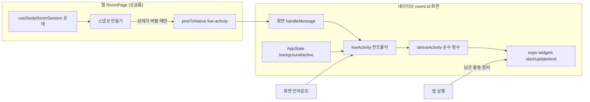

# BY-1359 iOS Live Activity 설계

## 배경

- 정책은 위키 `product/specs/BY-1354-자율-모드-백그라운드.md` 4절에 있고, 시안은 Figma V3 `잠금화면·알림` 섹션(12281:23064)이다.
- 공부 세션이 진행 중이면 잠금화면과 Dynamic Island에 과목, 모드, 공부 시간을 보여 준다.
- 자율 모드는 앱 밖에서도 시간이 흐르고, 관리 모드는 앱을 나가면 멈춘 시간과 일시정지 중임을 보여 준다.
- 스파이크(2026-11-21~22)에서 expo-widgets로 시작·갱신·일시정지·재개·종료·끝난 모양이 실기기와 시뮬레이터에서 동작하는 것을 확인했다.
- Android 진행 중 알림(BY-1360)과 로컬 알림(BY-1361)은 이 문서 범위 밖이다. 다만 브리지 메시지는 두 플랫폼이 같이 쓸 수 있게 플랫폼 중립으로 만든다.

## 결정 (2026-11-21 스파이크 때 사용자 승인, 모두 추천안)

| 번호 | 항목            | 결정                                                                           |
| ---- | --------------- | ------------------------------------------------------------------------------ |
| 1    | 라이브러리      | `expo-widgets ~57.0.28`의 `createLiveActivity`와 `@expo/ui/swift-ui`로 그린다  |
| 2    | 앱 밖 전환 감지 | 네이티브 JS의 `AppState`로 한다. 웹 메시지를 기다리지 않는다                   |
| 3    | 브리지          | 웹에서 네이티브로 가는 `live-activity` 한 종류만 둔다                          |
| 4    | 탭 동작         | URL을 넘기지 않는다. 누르면 앱이 열리고, 앱이 보이던 세션 화면이 그대로 나온다 |
| 5    | 휴식            | 일시정지 모양으로 그린다                                                       |
| 6    | 남은 활동       | 앱을 실행할 때 남아 있는 활동을 모두 끝낸다                                    |

스파이크 뒤 이 문서에서 정한 것은 아래와 같다.

| 번호 | 항목             | 결정                                                                                | 근거                                                                                                                                                 |
| ---- | ---------------- | ----------------------------------------------------------------------------------- | ---------------------------------------------------------------------------------------------------------------------------------------------------- |
| 7    | 휴식 문구        | `휴식 중이에요`를 따로 두지 않고 일시정지 문구를 쓴다                               | 휴식은 앱 안에서만 이어지고, 앱을 나가면 웹이 일시정지로 바꾼다. 앱이 앞에 있을 때는 자기 Live Activity가 보이지 않으므로 휴식 문구가 보일 일이 없다 |
| 8    | 끝난 모양의 시간 | 시간을 그리지 않는다                                                                | 시안이 제목과 사유만 보인다. 스파이크의 "끝난 모양에서도 시간이 올라감" 문제가 함께 없어진다                                                         |
| 9    | 실시간 현황 거부 | 시작 실패를 잡아 경고 로그만 남기고 세션은 그대로 진행한다                          | expo-widgets에 허용 여부를 묻는 API가 없다. 시작이 실패해도 공부 기록에는 영향이 없다                                                                |
| 10   | 끝난 모양 지연   | 대응하지 않는다                                                                     | 실기기에서 정한 시각보다 1~2분 늦게 바뀌었다. 기준이 20분·2시간이라 영향이 작다                                                                      |
| 11   | 대상 화면        | 싱글룸(`/room/:id`)만                                                               | 위키가 그룹 공부방과 소셜룸을 범위 밖으로 정했다. 네이티브에서 세션을 띄우는 화면도 `room/[id]` 하나다                                               |
| 12   | 기능 표시        | 앱이 웹뷰 URL에 `liveActivity=1`을 붙이고, 웹은 이 표시가 있을 때만 메시지를 보낸다 | 원격 웹은 구버전 앱에도 바로 배포된다. `alertHaptic`, `appLock`과 같은 방식이다                                                                      |
| 13   | 문구 언어        | 네이티브가 기기 언어로 문구를 만들어 props로 넘긴다                                 | 위젯 레이아웃 함수는 바깥 상수를 참조할 수 없다. 스크린타임 Shield 확장과 같은 방식이다                                                              |

## 화면 (시안 기준)

### 잠금화면 배너

| 상태                | 1줄                          | 2줄                            | 3줄                                                       |
| ------------------- | ---------------------------- | ------------------------------ | --------------------------------------------------------- |
| 흐름, 과목 있음     | 과목                         | 공부 시간                      | 모드 문구                                                 |
| 일시정지, 과목 있음 | 과목                         | 일시정지 표시와 멈춘 공부 시간 | `잠시 휴식 중이에요`와 줄바꿈, `돌아와서 이어서 공부해요` |
| 과목 없음           | 상태 문구                    | 공부 시간                      | 없음                                                      |
| 끝난 모양           | `여기까지 기록을 저장했어요` | 사유                           | 없음                                                      |

- 모드 문구는 자율 모드가 `자율 모드로 공부 중이에요`, 관리 모드가 `관리 모드로 공부 중이에요`다.
- 끝난 모양의 사유는 일시정지 20분이면 `일시정지가 20분을 넘었어요`, 자율 모드 2시간이면 `앱 밖에 2시간 넘게 있었어요`다.
- 왼쪽에 앱 아이콘(마스코트)을 둔다.
- 일시정지 표시는 SF Symbol `pause.fill`이다.
- 공부 시간은 OS가 직접 센다(`Text timerInterval`). 일시정지면 `pauseTime`으로 멈춘 값을 보인다.

### Dynamic Island

| 영역           | 흐름                                   | 일시정지                  | 끝난 모양   |
| -------------- | -------------------------------------- | ------------------------- | ----------- |
| compact 왼쪽   | 앱 아이콘                              | 앱 아이콘과 일시정지 표시 | 앱 아이콘   |
| compact 오른쪽 | 공부 시간                              | 멈춘 공부 시간            | 없음        |
| minimal        | 앱 아이콘                              | 일시정지 표시             | 앱 아이콘   |
| expanded       | 앱 아이콘과 과목, 공부 시간, 상태 문구 | 같은 배치에 일시정지 표시 | 제목과 사유 |

- 섬의 펼친 화면은 좁아 상태 문구가 두 줄이면 첫 줄(`잠시 휴식 중이에요`)만 보인다.
- 배경색은 지정하지 않고 iOS 기본 배경을 쓴다.
- Dynamic Island는 시뮬레이터 스크린샷에 내용이 찍히지 않고 사용자의 iPhone 13 mini에는 섬이 없어, 실기기 확인은 섬이 있는 기기가 생길 때 한다.

### 앱 아이콘

- `apps/mobile/assets/icon.png`(1024px)를 줄인 위젯 전용 PNG를 저장소에 둔다.
- 앱은 활동을 시작하기 전에 이 파일을 expo-widgets의 `widgetsDirectory`(App Group 공유 폴더)로 한 번 복사하고, 그 경로를 props로 넘긴다.
- 위젯은 `Image uiImage`로 그린다. 복사에 실패하면 아이콘 없이 그린다.

## 구조



### 브리지 메시지 `live-activity` (웹 → 네이티브)

```ts
{
  type: "live-activity";
  atMs: number;
  session: null | {
    mode: "timer" | "camera";
    subject: string | null;
    state: "running" | "paused" | "break" | "distracted";
    elapsedSec: number; // atMs 시점에 화면 큰 숫자가 보이던 값
  };
}
```

- `session: null`은 활동을 끝내라는 뜻이다.
- 웹은 상태가 바뀔 때만 보낸다. 매초 보내지 않는다. 기준은 측정 방식, 과목 이름, `running`/`paused`/`break`, 세션 진행 여부다.
- `elapsedSec`은 화면의 큰 숫자(`focusSec`)와 같은 값이다.
- 관리 모드의 딴짓 상태는 `distracted`로 보낸다. 세션은 이어지지만 큰 숫자가 멈추므로, 잠금화면도 시간만 멈추고 일시정지 표시는 하지 않는다.
- `bridge.ts` 첫머리의 "타이머와 상태 전환은 브리지를 건너지 않는다" 원칙에 이 메시지가 예외임을 적는다. 상태 전환 시점에만 보내고, 매초 값은 넘기지 않는다.
- 과목 이름은 사용자가 쓴 글이라 개발 로그(`forLog`)에서 가린다.

### 웹이 보내는 곳

- `RoomPage`의 싱글룸 세션 화면에서 보낸다. `useStudyRoomSession`은 소셜룸과 같이 쓰므로 훅 안에서 보내지 않는다.
- 스냅샷은 순수 함수로 만든다. 입력은 측정 방식, 과목 이름, 세션 상태, phase, `focusSec`이고 출력은 위 `session` 값이다.
  - phase가 `studying`이 아니면 `null`이다.
  - 휴식(`isBreak`)이면 `break`, 그 밖의 `PAUSE`면 `paused`, `DISTRACTION`이면 `distracted`, 나머지는 `running`이다.
- 같은 스냅샷을 두 번 보내지 않게, 시간 값을 뺀 키가 바뀔 때만 보낸다.
- 화면을 떠날 때(언마운트) `null`을 보낸다. 네이티브도 화면 언마운트 때 끝내므로 둘 중 하나만 닿아도 된다.
- `liveActivity=1` 표시가 없으면 아무것도 보내지 않는다. 읽는 방식은 `alertHapticCapability.ts`와 같다.

### 네이티브 컨트롤러 `apps/mobile/lib/liveActivity.ts`

- 상태는 마지막 웹 스냅샷과 앱 밖으로 나간 시각(`backgroundSinceMs`) 두 가지다.
- 웹 스냅샷이 오거나 AppState가 바뀌면 `deriveActivity`로 props와 `staleDate`를 계산하고 start, update, end 중 하나를 부른다.
- 활동이 없는데 `session`이 오면 시작하고, `null`이 오면 끝낸다.
- `room/[id]` 화면이 언마운트되면 끝낸다. 웹이 `null`을 보내기 전에 웹뷰가 사라지는 경우를 막는다.
- 앱을 실행할 때 `getInstances()`로 남은 활동을 찾아 모두 `immediate`로 끝낸다.
- iOS가 아니거나 네이티브 모듈이 없으면(구 Dev Client, jest) 아무 일도 하지 않는다.

### `deriveActivity` 규칙 (순수 함수)

입력은 스냅샷, `backgroundSinceMs`(앞이면 null), 문구 묶음이다. 출력은 props와 `staleDate`다.

| 앱 위치 | 스냅샷 상태        | 그리는 모양                               | staleDate          | 끝난 사유     |
| ------- | ------------------ | ----------------------------------------- | ------------------ | ------------- |
| 앞      | running            | 흐름                                      | 없음               | 없음          |
| 앞      | paused, break      | 일시정지                                  | 없음               | 없음          |
| 앞      | distracted         | 스냅샷 시각 값에서 시간만 멈춤, 모드 문구 | 없음               | 없음          |
| 밖      | running, 자율 모드 | 흐름                                      | 나간 시각 + 2시간  | 2시간         |
| 밖      | running, 관리 모드 | 나간 시각에 멈춘 일시정지                 | 나간 시각 + 20분   | 일시정지 20분 |
| 밖      | paused             | 일시정지                                  | 스냅샷 시각 + 20분 | 일시정지 20분 |
| 밖      | break              | 일시정지                                  | 나간 시각 + 20분   | 일시정지 20분 |
| 밖      | distracted         | 스냅샷 시각 값에서 멈춘 일시정지          | 나간 시각 + 20분   | 일시정지 20분 |

- 직접 누른 일시정지는 웹이 일시정지를 시작한 시각부터 20분을 세므로 스냅샷 시각을 기준으로 둔다.
- 휴식이나 딴짓 중에 나가면 웹이 그때 일시정지로 바꾸므로 나간 시각을 기준으로 둔다.
- 같은 멈춘 상태에서 과목만 바뀐 스냅샷이 오면 처음 스냅샷 시각을 유지한다. 일시정지 중 과목을 바꿔도 20분 기준이 밀리지 않게 하려는 것이다.
- 2시간과 20분은 웹 `AWAY_LIMIT_MS`, `autoEndPauseMinutes`와 같은 값이다. 네이티브는 웹 코드를 import할 수 없으니 상수를 따로 두고 주석으로 짝을 밝힌다.
- 흐름 모양의 기준 시각은 `startedAtMs = atMs - elapsedSec * 1000`이다. 일시정지 모양은 같은 기준에 `pausedAtMs = startedAtMs + elapsedSec * 1000`을 둔다. 관리 모드가 밖에서 멈출 때는 나간 시각까지 흐른 값으로 멈춘다.
- 돌아오면(`active`) `backgroundSinceMs`를 비우고 마지막 스냅샷으로 다시 그린다. `staleDate` 없이 update하면 끝난 모양이 풀린다.

### 위젯 props

```ts
type StudySessionActivityProps = {
  subject: string | null;
  paused: boolean;
  startedAtMs: number;
  pausedAtMs: number | null;
  statusText: string; // 모드 문구나 일시정지 문구
  islandStatusText: string; // statusText의 첫 줄, 펼친 섬용
  endedTitle: string; // 여기까지 기록을 저장했어요
  endedBody: string; // 끝난 사유
  iconUri: string | null;
};
```

- 위젯은 `environment.isStale`이면 끝난 모양을, 아니면 `paused`로 흐름과 일시정지 모양을 고른다.
- 끝난 사유는 `staleDate`가 있을 때만 의미가 있다. 앞에 있을 때도 사유 문구는 채워 두되 보이지 않는다.
- 위젯 레이아웃 함수에는 역슬래시를 쓰지 않는다. `babel-preset-expo`가 이 함수를 템플릿 리터럴 문자열로 바꿀 때 역슬래시를 이스케이프하지 않아, `"\n"`이 실제 줄바꿈이 되면 위젯 확장이 해석하지 못한다. 문자열 가공은 `deriveActivity`에서 하고 결과를 props로 넘긴다.

### 문구와 언어

- 네이티브 `lib/i18n.ts`에 `liveActivity.*` 키를 ko, en, ja, zh-Hant로 더한다.
- 모드 이름은 웹 번역(`Self-guided Mode`/`Camera Mode`, `自主モード`/`カメラモード`, `自主模式`/`相機模式`)과 맞춘다.
- `여기까지 기록을 저장했어요`와 두 사유는 웹 `study-session.json`의 자동 종료 안내 번역이 있으면 그 표현을 따른다.
- 문구는 활동을 시작하거나 갱신할 때 그 시점의 기기 언어로 만든다.

## 앱 설정

- `app.config.ts`의 `expo-widgets` 플러그인은 스파이크 설정을 유지한다(App Group은 스크린타임 확장과 같은 `group.<bundleIdentifier>`).
- 운영·스테이징의 위젯 App ID(`<bundleIdentifier>.ExpoWidgetsTarget`)에도 App Group을 배정해야 하고, 그 뒤 대화형 EAS 빌드로 프로필을 새로 받아야 한다. 코드 밖 작업이라 출시 전에 따로 한다.
- 앱 `Info.plist`의 `NSSupportsLiveActivities`는 플러그인이 넣는다.

## 오류 처리

- 시작, 갱신, 종료가 실패하면 경고 로그만 남긴다. 세션과 기록에는 영향을 주지 않는다.
- 아이콘 복사에 실패하면 `iconUri: null`로 그린다.
- 웹 스냅샷 파싱이 실패하면 `parseToNativeMessage`가 버린다.

## 테스트

- 네이티브
  - `deriveActivity`: 위 규칙 표의 여섯 행, 과목 없음, 관리 모드가 밖에서 멈출 때의 값.
  - 컨트롤러: 스냅샷 시작, 갱신, `null` 종료, 화면 언마운트 종료, background·active 전환이 update를 부르는지(expo-widgets 모듈 mock).
  - `parseToNativeMessage`의 `live-activity` 검증.
  - `buildRemoteQueryParams`의 `liveActivity=1`과 이를 기대하는 화면 테스트 URI.
  - i18n 키가 네 언어에 모두 있는지(기존 `satisfies`가 컴파일로 잡는다).
- 웹
  - 스냅샷 순수 함수: phase, 휴식, 일시정지, 과목 없음.
  - 기능 표시 읽기 함수.
  - 같은 키면 다시 보내지 않는지, 표시가 없으면 보내지 않는지.
- 실기기
  - 두 모드의 시작, 일시정지, 재개, 종료, 끝난 모양을 스파이크 때와 같은 절차로 다시 본다.

## 범위 밖

- Android 진행 중 알림(BY-1360), 로컬 알림(BY-1361).
- 잠금화면의 일시정지·재개 버튼(후속 티켓).
- 그룹 공부방과 소셜룸.
- 푸시로 Live Activity를 갱신하는 서버 연동.
